# Laporan Resmi Praktikum Komunikasi Data & Jaringan Komputer 2026 — Modul 5 (*Operation Geofront*)

## Member

| Nama                      | NRP        |
| ------------------------- | ---------- |
| Wildan Alfarezy       | 5027251088 |
| Ashkhabil Abror Budihardjo | 5027251049 |

---

## Arsitektur & Topologi GNS3

Topologi **Operation Geofront** terdiri dari **60 node** yang dibangun di GNS3 menggunakan image Docker resmi **`ardhptr21/debinet:latest`** dan **`ardhptr21/alpinet:latest`**:
- **1 `NAT1`** (terhubung eksklusif ke `Gendou` via DHCP)
- **17 Router:**
  - `debinet`: `Gendou`, `Fuyutsuki`, `Shigeru`, `Misato` (router yang menjalankan NAT, firewall, `conntrack`, dan script sabotase)
  - `alpinet`: `Yui`, `Rei`, `Shinji`, `Mari`, `Hikari`, `Kaworu`, `Asuka`, `Kensuke`, `Ritsuko`, `Kaji`, `Makoto`, `Maya`, `Toji`
- **17 `Ethernet switch`** (`Switch-Quarters` s/d `Switch-Cmd`)
- **25 Host / Server Container:**
  - `debinet`: `Tokyo3-Core`, `Magi-Casper`, `Magi-Balthasar`, `Magi-Melchior`, `Pen-Pen` (membutuhkan paket Debian `netcat-traditional`, `iptables`, `apt-get`)
  - `alpinet`: `Quarters`, `Comm-Net`, `Hangar-Crew`, `Sachiel`, `Medic-Bay`, `Relay-Node`, `Garden-Staff`, `Dock-Crew`, `Entry-Plug`, `Dummy-Plug`, `Unit-01`, `Unit-02`, `Unit-00`, `Lilith`, `Adam`, `Zeruel`, `Armisael`, `Radar-Array`, `Archive-Vault`, `Spy`

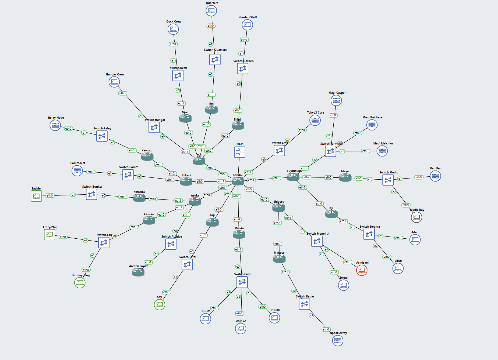

---

# Babak 1: Membangun Geofront

## Soal 1 — Markas Tanpa Peta (VLSM & Pohon Pembagian IP)

### Aturan Pembagian VLSM
- Prefix kelompok: **`192.223.0.0/16`**
- Kebutuhan alamat tiap LAN: `Jumlah Host + 1 (Gateway) + 2 (Network & Broadcast)`, menggunakan prefix terkecil yang muat.
- Kebutuhan tiap Link Antar-Router (16 link): `2 Router + 2 (Network & Broadcast) = 4 alamat (/30)`.
- Urutan alokasi: dari ukuran blok subnet terbesar ke terkecil. Sesuai ketentuan *tie-break*, jika ukuran blok sama maka **LAN didahulukan daripada Link**, lalu mengikuti **urutan Tabel Host**.
- Penomoran host pada switch mengikuti urutan penulisan node **kiri ke kanan** pada topologi (gateway selalu IP *usable* pertama).

### Tabel Pembagian VLSM (17 LAN + 16 Link Antar-Router)
File spreadsheet lengkap juga tersedia pada [tabel_vlsm_k24.csv](tabel_vlsm_k24.csv).

| No | Segmen / Subnet | Kebutuhan (Host+GW) | Network | Prefix | Gateway / Router | Broadcast | IP Terpakai | Sisa Usable | Alokasi IP Container di GNS3 |
| :-: | :--- | :-: | :--- | :-: | :--- | :--- | :--- | :-: | :--- |
| 1 | `Switch-Quarters` | 500 + 1 = **501** | `192.223.0.0` | `/23` | `192.223.0.1` (`Rei`) | `192.223.1.255` | 501 (`192.223.0.1` – `192.223.1.245`) | **9** | `Quarters` = `192.223.0.2` |
| 2 | `Switch-Comm` | 200 + 1 = **201** | `192.223.2.0` | `/24` | `192.223.2.1` (`Hikari`) | `192.223.2.255` | 201 (`192.223.2.1` – `192.223.2.201`) | **53** | `Comm-Net` = `192.223.2.2` |
| 3 | `Switch-Hangar` | 100 + 1 = **101** | `192.223.3.0` | `/25` | `192.223.3.1` (`Yui`) | `192.223.3.127` | 101 (`192.223.3.1` – `192.223.3.101`) | **25** | `Hangar-Crew` = `192.223.3.2` |
| 4 | `Switch-Bunker` | 55 + 1 = **56** | `192.223.3.128` | `/26` | `192.223.3.129` (`Kensuke`) | `192.223.3.191` | 56 (`192.223.3.129` – `192.223.3.184`) | **6** | `Sachiel` = `192.223.3.130` |
| 5 | `Switch-Medic` | 26 + 1 = **27** | `192.223.3.192` | `/27` | `192.223.3.193` (`Maya`) | `192.223.3.223` | 27 (`192.223.3.193` – `192.223.3.219`) | **3** | `Medic-Bay` = `.3.194`, `Pen-Pen` = `.3.195` |
| 6 | `Switch-Relay` | 25 + 1 = **26** | `192.223.3.224` | `/27` | `192.223.3.225` (`Kaworu`) | `192.223.3.255` | 26 (`192.223.3.225` – `192.223.3.250`) | **4** | `Relay-Node` = `192.223.3.226` |
| 7 | `Switch-Garden` | 14 + 1 = **15** | `192.223.4.0` | `/27` | `192.223.4.1` (`Shinji`) | `192.223.4.31` | 15 (`192.223.4.1` – `192.223.4.15`) | **15** | `Garden-Staff` = `192.223.4.2` |
| 8 | `Switch-Dock` | 12 + 1 = **13** | `192.223.4.32` | `/28` | `192.223.4.33` (`Mari`) | `192.223.4.47` | 13 (`192.223.4.33` – `192.223.4.45`) | **1** | `Dock-Crew` = `192.223.4.34` |
| 9 | **`Switch-Lab`** *(dilingkari)* | 5 + 1 = **6** | `192.223.4.48` | `/29` | `192.223.4.49` (`Ritsuko`) | `192.223.4.55` | 6 (`192.223.4.49` – `192.223.4.54`) | **0** | `Entry-Plug` = `.4.50`, `Dummy-Plug` = `.4.51` |
| 10 | `Switch-Terminal` | 3 + 1 = **4** | `192.223.4.56` | `/29` | `192.223.4.57` (`Fuyutsuki`) | `192.223.4.63` | 4 (`192.223.4.57` – `192.223.4.60`) | **2** | `Casper` = `.4.58`, `Balthasar` = `.4.59`, `Melchior` = `.4.60` |
| 11 | `Switch-Cage` | 3 + 1 = **4** | `192.223.4.64` | `/29` | `192.223.4.65` (`Misato`) | `192.223.4.71` | 4 (`192.223.4.65` – `192.223.4.68`) | **2** | `Unit-01` = `.4.66`, `Unit-02` = `.4.67`, `Unit-00` = `.4.68` |
| 12 | `Switch-Dogma` | 2 + 1 = **3** | `192.223.4.72` | `/29` | `192.223.4.73` (`Toji`) | `192.223.4.79` | 3 (`192.223.4.73` – `192.223.4.75`) | **3** | `Lilith` = `.4.74`, `Adam` = `.4.75` |
| 13 | **`Switch-Monolith`** *(dilingkari)* | 2 + 1 = **3** | `192.223.4.80` | `/29` | `192.223.4.81` (`Shigeru`) | `192.223.4.87` | 3 (`192.223.4.81` – `192.223.4.83`) | **3** | `Zeruel` = `.4.82`, `Armisael` = `.4.83` |
| 14 | `Switch-Radar` | 4 + 1 = **5** | `192.223.4.88` | `/29` | `192.223.4.89` (`Makoto`) | `192.223.4.95` | 5 (`192.223.4.89` – `192.223.4.93`) | **1** | `Radar-Array` = `192.223.4.90` |
| 15 | `Switch-Archive` | 1 + 1 = **2** | `192.223.4.96` | `/30` | `192.223.4.97` (`Asuka`) | `192.223.4.99` | 2 (`192.223.4.97` – `192.223.4.98`) | **0** | `Archive-Vault` = `192.223.4.98` |
| 16 | `Switch-Intel` | 1 + 1 = **2** | `192.223.4.100` | `/30` | `192.223.4.101` (`Kaji`) | `192.223.4.103` | 2 (`192.223.4.101` – `192.223.4.102`) | **0** | `Spy` = `192.223.4.102` |
| 17 | `Switch-Cmd` | 1 + 1 = **2** | `192.223.4.104` | `/30` | `192.223.4.105` (`Gendou`) | `192.223.4.107` | 2 (`192.223.4.105` – `192.223.4.106`) | **0** | `Tokyo3-Core` = `192.223.4.106` |
| 18 | `Link Gendou - Yui` | **2** | `192.223.4.108` | `/30` | `-` | `192.223.4.111` | 2 (`192.223.4.109` – `.110`) | **0** | `Gendou` = `.4.109`, `Yui` = `.4.110` |
| 19 | `Link Gendou - Hikari` | **2** | `192.223.4.112` | `/30` | `-` | `192.223.4.115` | 2 (`192.223.4.113` – `.114`) | **0** | `Gendou` = `.4.113`, `Hikari` = `.4.114` |
| 20 | **`Link Gendou - Asuka`** *(dilingkari)* | **2** | `192.223.4.116` | `/30` | `-` | `192.223.4.119` | 2 (`192.223.4.117` – `.118`) | **0** | `Gendou` = `.4.117`, `Asuka` = `.4.118` |
| 21 | `Link Gendou - Kaji` | **2** | `192.223.4.120` | `/30` | `-` | `192.223.4.123` | 2 (`192.223.4.121` – `.122`) | **0** | `Gendou` = `.4.121`, `Kaji` = `.4.122` |
| 22 | `Link Gendou - Misato` | **2** | `192.223.4.124` | `/30` | `-` | `192.223.4.127` | 2 (`192.223.4.125` – `.126`) | **0** | `Gendou` = `.4.125`, `Misato` = `.4.126` |
| 23 | **`Link Gendou - Shigeru`** *(dilingkari)* | **2** | `192.223.4.128` | `/30` | `-` | `192.223.4.131` | 2 (`192.223.4.129` – `.130`) | **0** | `Gendou` = `.4.129`, `Shigeru` = `.4.130` |
| 24 | `Link Gendou - Fuyutsuki` | **2** | `192.223.4.132` | `/30` | `-` | `192.223.4.135` | 2 (`192.223.4.133` – `.134`) | **0** | `Gendou` = `.4.133`, `Fuyutsuki` = `.4.134` |
| 25 | `Link Asuka - Kensuke` | **2** | `192.223.4.136` | `/30` | `-` | `192.223.4.139` | 2 (`192.223.4.137` – `.138`) | **0** | `Asuka` = `.4.137`, `Kensuke` = `.4.138` |
| 26 | **`Link Asuka - Ritsuko`** *(dilingkari)* | **2** | `192.223.4.140` | `/30` | `-` | `192.223.4.143` | 2 (`192.223.4.141` – `.142`) | **0** | `Asuka` = `.4.141`, `Ritsuko` = `.4.142` |
| 27 | `Link Fuyutsuki - Maya` | **2** | `192.223.4.144` | `/30` | `-` | `192.223.4.147` | 2 (`192.223.4.145` – `.146`) | **0** | `Fuyutsuki` = `.4.145`, `Maya` = `.4.146` |
| 28 | `Link Fuyutsuki - Toji` | **2** | `192.223.4.148` | `/30` | `-` | `192.223.4.151` | 2 (`192.223.4.149` – `.150`) | **0** | `Fuyutsuki` = `.4.149`, `Toji` = `.4.150` |
| 29 | `Link Yui - Rei` | **2** | `192.223.4.152` | `/30` | `-` | `192.223.4.155` | 2 (`192.223.4.153` – `.154`) | **0** | `Yui` = `.4.153`, `Rei` = `.4.154` |
| 30 | `Link Yui - Shinji` | **2** | `192.223.4.156` | `/30` | `-` | `192.223.4.159` | 2 (`192.223.4.157` – `.158`) | **0** | `Yui` = `.4.157`, `Shinji` = `.4.158` |
| 31 | `Link Yui - Mari` | **2** | `192.223.4.160` | `/30` | `-` | `192.223.4.163` | 2 (`192.223.4.161` – `.162`) | **0** | `Yui` = `.4.161`, `Mari` = `.4.162` |
| 32 | `Link Hikari - Kaworu` | **2** | `192.223.4.164` | `/30` | `-` | `192.223.4.167` | 2 (`192.223.4.165` – `.166`) | **0** | `Hikari` = `.4.165`, `Kaworu` = `.4.166` |
| 33 | `Link Shigeru - Makoto` | **2** | `192.223.4.168` | `/30` | `-` | `192.223.4.171` | 2 (`192.223.4.169` – `.170`) | **0** | `Shigeru` = `.4.169`, `Makoto` = `.4.170` |

### Gambar Pohon Pembagian IP (VLSM)
Lingkaran merah menandai **5 subnet** pada jalur paket dari **`Dummy-Plug`** menuju **`Armisael`**:
1. `192.223.4.48/29` (`Switch-Lab`: `Dummy-Plug` -> `Ritsuko`)
2. `192.223.4.140/30` (`Link Asuka - Ritsuko`)
3. `192.223.4.116/30` (`Link Gendou - Asuka`)
4. `192.223.4.128/30` (`Link Gendou - Shigeru`)
5. `192.223.4.80/29` (`Switch-Monolith`: `Shigeru` -> `Armisael`)


### Penjelasan Perhitungan Satu Subnet (`Switch-Medic`, Urutan ke-5)
- **Kebutuhan alamat:** Pada `Switch-Medic` terdapat `Pen-Pen` (1 host) dan `Medic-Bay` (25 host), ditambah 1 alamat gateway (`Maya`) serta 2 alamat khusus (*Network* dan *Broadcast*):
  $$\text{Total Alamat} = (1 + 25) + 1\text{ (Gateway)} + 2\text{ (Network \& Broadcast)} = 29\text{ alamat}$$
- **Penentuan prefix terkecil:** Dicari pangkat $2^n \ge 29$, diperoleh $2^5 = 32$ alamat ($n = 5$), sehingga prefix terkecil yang muat adalah $32 - 5 = \mathbf{/27}$ (`255.255.255.224`) dengan kapasitas IP *usable* sebesar $32 - 2 = 30$ IP.
- **Penentuan alamat & sisa:** Karena subnet sebelumnya (`Switch-Bunker`, `192.223.3.128/26`) berakhir di *broadcast* `192.223.3.191`, maka `Switch-Medic` dimulai tepat setelahnya:
  - **Network:** `192.223.3.192/27`
  - **Gateway (`Maya`):** `192.223.3.193`
  - **Alokasi Container (kiri -> kanan pada topologi):** `Medic-Bay` = `192.223.3.194`, `Pen-Pen` = `192.223.3.195`
  - **Broadcast:** `192.223.3.223` ($192 + 32 - 1 = 223$)
  - **IP Terpakai & Sisa:** Terpakai $27$ IP *usable* (26 host + 1 gateway), sehingga sisa IP *usable* = $30 - 27 = \mathbf{3\text{ IP}}$.

---

## Soal 2 — Geofront Gelap Gulita (Konfigurasi IP Router & IP Forwarding)

Setiap router diberi alamat IP pada `/etc/network/interfaces` sesuai pemetaan kabel `eth` pada kanvas GNS3 dan langsung mengaktifkan IP forwarding (`sysctl -w net.ipv4.ip_forward=1`). Hanya **`Gendou`** yang terhubung ke `NAT1` melalui `eth0` menggunakan **DHCP**.

### Konfigurasi `/etc/network/interfaces` Router Utama (Sesuai Kabel Aktual Kanvas GNS3)

<details>
<summary><b>Klik untuk melihat konfigurasi /etc/network/interfaces lengkap seluruh 17 Router</b></summary>

**1. `Gendou`** (`eth0`->NAT1, `eth1`->Switch-Cmd, `eth2`->Yui, `eth3`->Hikari, `eth4`->Fuyutsuki, `eth5`->Shigeru, `eth6`->Misato, `eth7`->Asuka, `eth8`->Kaji):
```ini
auto eth0
iface eth0 inet dhcp
    up sysctl -w net.ipv4.ip_forward=1

auto eth1
iface eth1 inet static
    address 192.223.4.105
    netmask 255.255.255.252

auto eth2
iface eth2 inet static
    address 192.223.4.109
    netmask 255.255.255.252

auto eth3
iface eth3 inet static
    address 192.223.4.113
    netmask 255.255.255.252

auto eth4
iface eth4 inet static
    address 192.223.4.133
    netmask 255.255.255.252

auto eth5
iface eth5 inet static
    address 192.223.4.129
    netmask 255.255.255.252

auto eth6
iface eth6 inet static
    address 192.223.4.125
    netmask 255.255.255.252

auto eth7
iface eth7 inet static
    address 192.223.4.117
    netmask 255.255.255.252

auto eth8
iface eth8 inet static
    address 192.223.4.121
    netmask 255.255.255.252
```

**2. `Yui`** (`eth0`->Gendou, `eth1`->Rei, `eth2`->Shinji, `eth3`->Mari, `eth4`->Switch-Hangar):
```ini
auto eth0
iface eth0 inet static
    address 192.223.4.110
    netmask 255.255.255.252
    up sysctl -w net.ipv4.ip_forward=1

auto eth1
iface eth1 inet static
    address 192.223.4.153
    netmask 255.255.255.252

auto eth2
iface eth2 inet static
    address 192.223.4.157
    netmask 255.255.255.252

auto eth3
iface eth3 inet static
    address 192.223.4.161
    netmask 255.255.255.252

auto eth4
iface eth4 inet static
    address 192.223.3.1
    netmask 255.255.255.128
```

**3. `Asuka`** (`eth0`->Gendou, `eth1`->Switch-Archive, `eth2`->Ritsuko, `eth3`->Kensuke):
```ini
auto eth0
iface eth0 inet static
    address 192.223.4.118
    netmask 255.255.255.252
    up sysctl -w net.ipv4.ip_forward=1

auto eth1
iface eth1 inet static
    address 192.223.4.97
    netmask 255.255.255.252

auto eth2
iface eth2 inet static
    address 192.223.4.141
    netmask 255.255.255.252

auto eth3
iface eth3 inet static
    address 192.223.4.137
    netmask 255.255.255.252
```

**4. `Fuyutsuki`** (`eth0`->Gendou, `eth1`->Switch-Terminal, `eth2`->Maya, `eth3`->Toji):
```ini
auto eth0
iface eth0 inet static
    address 192.223.4.134
    netmask 255.255.255.252
    up sysctl -w net.ipv4.ip_forward=1

auto eth1
iface eth1 inet static
    address 192.223.4.57
    netmask 255.255.255.248

auto eth2
iface eth2 inet static
    address 192.223.4.145
    netmask 255.255.255.252

auto eth3
iface eth3 inet static
    address 192.223.4.149
    netmask 255.255.255.252
```

**5. `Shigeru`** (`eth0`->Gendou, `eth1`->Switch-Monolith, `eth2`->Makoto):
```ini
auto eth0
iface eth0 inet static
    address 192.223.4.130
    netmask 255.255.255.252
    up sysctl -w net.ipv4.ip_forward=1

auto eth1
iface eth1 inet static
    address 192.223.4.81
    netmask 255.255.255.248

auto eth2
iface eth2 inet static
    address 192.223.4.169
    netmask 255.255.255.252
```

**6. `Hikari`** (`eth0`->Gendou, `eth1`->Switch-Comm, `eth2`->Kaworu):
```ini
auto eth0
iface eth0 inet static
    address 192.223.4.114
    netmask 255.255.255.252
    up sysctl -w net.ipv4.ip_forward=1

auto eth1
iface eth1 inet static
    address 192.223.2.1
    netmask 255.255.255.0

auto eth2
iface eth2 inet static
    address 192.223.4.165
    netmask 255.255.255.252
```

**7. 11 Router Ujung** (`eth0` ke router induk `/30`, `eth1` ke switch masing-masing):
- `Rei`: `eth0=192.223.4.154/30`, `eth1=192.223.0.1/23`
- `Shinji`: `eth0=192.223.4.158/30`, `eth1=192.223.4.1/27`
- `Mari`: `eth0=192.223.4.162/30`, `eth1=192.223.4.33/28`
- `Kaworu`: `eth0=192.223.4.166/30`, `eth1=192.223.3.225/27`
- `Kensuke`: `eth0=192.223.4.138/30`, `eth1=192.223.3.129/26`
- `Ritsuko`: `eth0=192.223.4.142/30`, `eth1=192.223.4.49/29`
- `Kaji`: `eth0=192.223.4.122/30`, `eth1=192.223.4.101/30`
- `Misato`: `eth0=192.223.4.126/30`, `eth1=192.223.4.65/29`
- `Makoto`: `eth0=192.223.4.170/30`, `eth1=192.223.4.89/29`
- `Maya`: `eth0=192.223.4.146/30`, `eth1=192.223.3.193/27`
- `Toji`: `eth0=192.223.4.150/30`, `eth1=192.223.4.73/29`

</details>

### Perintah Verifikasi Soal 2
```bash
# Cek interface & status ip_forward di tiap router
ip -br a
cat /proc/sys/net/ipv4/ip_forward

# Uji ping 7 link dari Gendou
for ip in 192.223.4.110 192.223.4.114 192.223.4.118 192.223.4.122 192.223.4.126 192.223.4.130 192.223.4.134; do
  ping -c 1 $ip | grep -E "PING|bytes from"
done
```

#### Bukti `ip -br a` dan Ping ke Seluruh 7 Router Anak dari `Gendou`
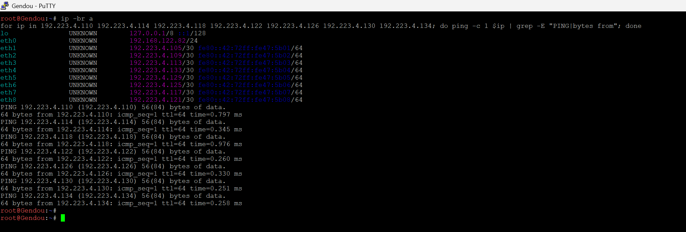

---

## Soal 3 — Pulau-Pulau yang Terpisah (Static Routing & Route Summarization)

Semua router selain `Gendou` cukup memiliki **1 default route ke atas** ditambah rute statis hanya untuk subnet di bawahnya. Seluruh script menggunakan `ip route replace` dan diletakkan di `/root/<nama>.sh` agar idempotent (tidak dobel saat dijalankan ulang).

### Ringkasan CIDR (*Route Summarization*) pada `Gendou`
- `192.223.4.80/29` (`Switch-Monolith`) + `192.223.4.88/29` (`Switch-Radar`) -> diringkas menjadi **`192.223.4.80/28`** via `Shigeru` (`192.223.4.130`).
- `192.223.4.136/30` (`Asuka-Kensuke`) + `192.223.4.140/30` (`Asuka-Ritsuko`) -> diringkas menjadi **`192.223.4.136/29`** via `Asuka` (`192.223.4.118`).
- `192.223.4.144/30` (`Fuyutsuki-Maya`) + `192.223.4.148/30` (`Fuyutsuki-Toji`) -> diringkas menjadi **`192.223.4.144/29`** via `Fuyutsuki` (`192.223.4.134`).
- `192.223.4.152/30` (`Yui-Rei`) + `192.223.4.156/30` (`Yui-Shinji`) -> diringkas menjadi **`192.223.4.152/29`** via `Yui` (`192.223.4.110`).

### Script Routing Router (`/root/<nama>.sh`)
- **`/root/yui.sh`:**
  ```sh
  #!/bin/sh
  sysctl -w net.ipv4.ip_forward=1
  ip route replace default via 192.223.4.109
  ip route replace 192.223.0.0/23 via 192.223.4.154
  ip route replace 192.223.4.0/27 via 192.223.4.158
  ip route replace 192.223.4.32/28 via 192.223.4.162
  ```
- **`/root/hikari.sh`:**
  ```sh
  #!/bin/sh
  sysctl -w net.ipv4.ip_forward=1
  ip route replace default via 192.223.4.113
  ip route replace 192.223.3.224/27 via 192.223.4.166
  ```
- **`/root/asuka.sh`:**
  ```sh
  #!/bin/sh
  sysctl -w net.ipv4.ip_forward=1
  ip route replace default via 192.223.4.117
  ip route replace 192.223.3.128/26 via 192.223.4.138
  ip route replace 192.223.4.48/29 via 192.223.4.142
  ```
- **`/root/shigeru.sh`:**
  ```sh
  #!/bin/sh
  echo "nameserver 8.8.8.8" > /etc/resolv.conf
  sysctl -w net.ipv4.ip_forward=1
  ip route replace default via 192.223.4.129
  ip route replace 192.223.4.88/29 via 192.223.4.170
  ```
- **`/root/fuyutsuki.sh`:**
  ```sh
  #!/bin/sh
  sysctl -w net.ipv4.ip_forward=1
  ip route replace default via 192.223.4.133
  ip route replace 192.223.3.192/27 via 192.223.4.146
  ip route replace 192.223.4.72/29 via 192.223.4.150
  ```
- **11 Router Ujung** (`rei.sh`, `shinji.sh`, `mari.sh`, `kaworu.sh`, `kensuke.sh`, `ritsuko.sh`, `kaji.sh`, `misato.sh`, `makoto.sh`, `maya.sh`, `toji.sh`): masing-masing berisi `sysctl -w net.ipv4.ip_forward=1` dan 1 baris `ip route replace default via <IP_Router_Induk>`.
- **`/root/gendo.sh`**: berisi 21 rute statis teringkas menuju seluruh cabang (digabung bersama NAT & Firewall pada bagian Soal 5 di bawah).

### Uji Konektivitas & Bukti Soal 3
```bash
# Cek tabel routing & summarization di Gendou
ip route

# Uji ping dari Armisael (192.223.4.83/29) ke Lilith, Sachiel, dan Comm-Net
ping -c 2 192.223.4.74    # Lilith
ping -c 2 192.223.3.130   # Sachiel
ping -c 2 192.223.2.2     # Comm-Net
```

#### Bukti Tabel Routing & Summarization (`/28` dan `/29`) di `Gendou`
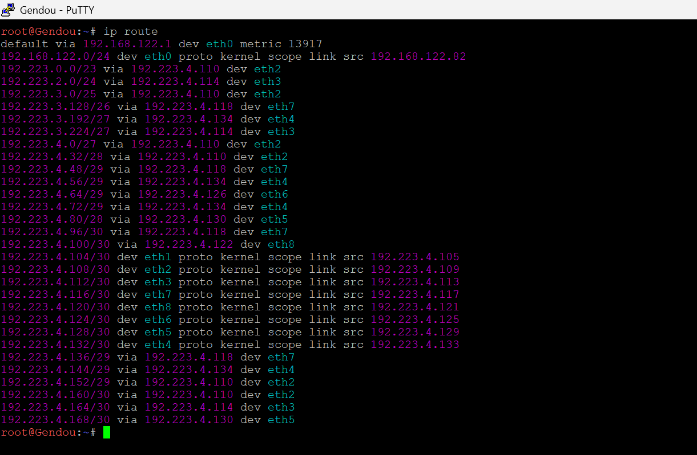

#### Bukti `Armisael` Berhasil Ping ke `Lilith`, `Sachiel`, dan `Comm-Net`


---

## Soal 4 — Haus Kabar dari Dunia Luar (NAT `MASQUERADE` & DNS)

Untuk memberikan akses internet ke seluruh subnet internal lewat `Gendou` tanpa perlu mengubah konfigurasi saat IP DHCP dari `NAT1` berubah, digunakan target **`MASQUERADE`** khusus untuk sumber prefix internal `192.223.0.0/16` yang keluar lewat interface `NAT1` (`eth0`). Traffic antar-LAN tidak melewati `eth0` sehingga tetap mempertahankan IP sumber aslinya.

### Perintah & Konfigurasi di `Gendou`
```bash
apt-get update && apt-get install -y iptables
NAT_IF=$(ip route show default | awk '{print $5; exit}')
iptables -t nat -F POSTROUTING
iptables -t nat -A POSTROUTING -s 192.223.0.0/16 -o "$NAT_IF" -j MASQUERADE
```

### Pengujian di `Armisael` & `Lilith`
```bash
echo "nameserver 8.8.8.8" > /etc/resolv.conf
ping -c 3 8.8.8.8
ping -c 3 deb.debian.org
```

#### Bukti Pengujian `Armisael` (`ping 8.8.8.8` & `ping deb.debian.org`)
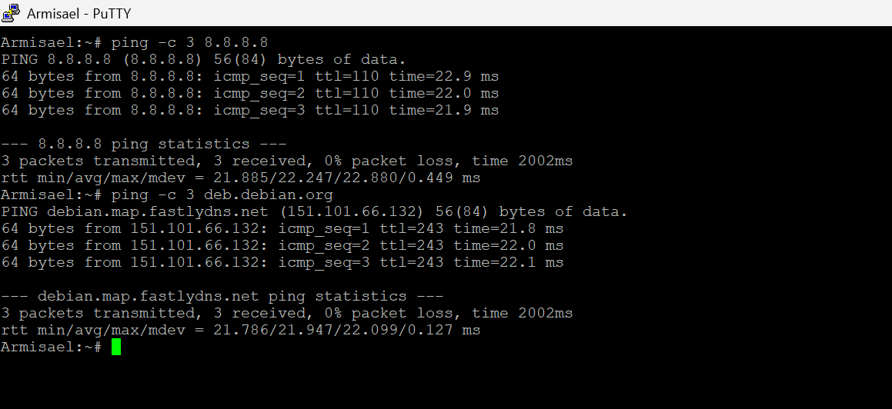

#### Bukti Pengujian `Lilith` (`ping 8.8.8.8` & `ping deb.debian.org`)


#### Bukti Counter Rule NAT `MASQUERADE` di `Gendou` (`pkts` & `bytes` Naik)
```bash
iptables -t nat -L POSTROUTING -v -n
```
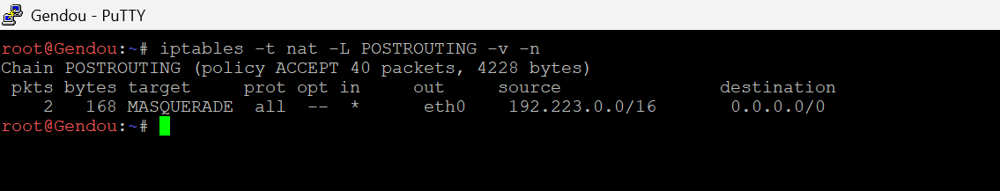

---

## Soal 5 — Pintu Depan Dikunci Rapat (Firewall `Gendou` Policy `DROP`)

Policy `INPUT` dan `FORWARD` pada `Gendou` diubah menjadi **`DROP`** sehingga koneksi baru dari sisi `NAT1` (`eth0`) otomatis ditolak, sementara loopback, DHCP `NAT1` (UDP sport `67` -> dport `68`), balasan `ESTABLISHED,RELATED`, akses internal ke `Gendou`, internal ke internet, dan lalu lintas antar-LAN tetap diizinkan. Seluruh konfigurasi Soal 2–5 disatukan dalam **`/root/gendo.sh`**.

### Script Lengkap `/root/gendo.sh`
```sh
#!/bin/sh
# === SOAL 2: IP Forwarding ===
sysctl -w net.ipv4.ip_forward=1

# === SOAL 3: Static Routing + Summarization ===
# Cabang Yui (via 192.223.4.110)
ip route replace 192.223.0.0/23 via 192.223.4.110
ip route replace 192.223.3.0/25 via 192.223.4.110
ip route replace 192.223.4.0/27 via 192.223.4.110
ip route replace 192.223.4.32/28 via 192.223.4.110
ip route replace 192.223.4.152/29 via 192.223.4.110
ip route replace 192.223.4.160/30 via 192.223.4.110

# Cabang Hikari (via 192.223.4.114)
ip route replace 192.223.2.0/24 via 192.223.4.114
ip route replace 192.223.3.224/27 via 192.223.4.114
ip route replace 192.223.4.164/30 via 192.223.4.114

# Cabang Asuka (via 192.223.4.118)
ip route replace 192.223.3.128/26 via 192.223.4.118
ip route replace 192.223.4.48/29 via 192.223.4.118
ip route replace 192.223.4.96/30 via 192.223.4.118
ip route replace 192.223.4.136/29 via 192.223.4.118

# Cabang Kaji (via 192.223.4.122)
ip route replace 192.223.4.100/30 via 192.223.4.122

# Cabang Misato (via 192.223.4.126)
ip route replace 192.223.4.64/29 via 192.223.4.126

# Cabang Shigeru (via 192.223.4.130) - Switch-Monolith & Switch-Radar diringkas jadi /28
ip route replace 192.223.4.80/28 via 192.223.4.130
ip route replace 192.223.4.168/30 via 192.223.4.130

# Cabang Fuyutsuki (via 192.223.4.134)
ip route replace 192.223.3.192/27 via 192.223.4.134
ip route replace 192.223.4.56/29 via 192.223.4.134
ip route replace 192.223.4.72/29 via 192.223.4.134
ip route replace 192.223.4.144/29 via 192.223.4.134

# Deteksi interface NAT1 (default eth0)
NAT_IF=$(ip route show default | awk '{print $5; exit}')
[ -z "$NAT_IF" ] && NAT_IF="eth0"

# === SOAL 4: NAT MASQUERADE ===
iptables -t nat -F POSTROUTING
iptables -t nat -A POSTROUTING -s 192.223.0.0/16 -o "$NAT_IF" -j MASQUERADE

# === SOAL 5: Firewall Gendou (Policy INPUT & FORWARD = DROP) ===
iptables -F
iptables -X
iptables -P INPUT DROP
iptables -P FORWARD DROP
iptables -P OUTPUT ACCEPT

# INPUT: Loopback, ESTABLISHED/RELATED, DHCP dari NAT1, dan internal -> Gendou
iptables -A INPUT -i lo -j ACCEPT
iptables -A INPUT -m conntrack --ctstate ESTABLISHED,RELATED -j ACCEPT
iptables -A INPUT -i "$NAT_IF" -p udp --sport 67 --dport 68 -j ACCEPT
iptables -A INPUT ! -i "$NAT_IF" -s 192.223.0.0/16 -j ACCEPT

# FORWARD: (a) ESTABLISHED/RELATED, (b) Internal -> Internet, (c) Antar-LAN
iptables -A FORWARD -m conntrack --ctstate ESTABLISHED,RELATED -j ACCEPT
iptables -A FORWARD ! -i "$NAT_IF" -o "$NAT_IF" -s 192.223.0.0/16 -j ACCEPT
iptables -A FORWARD ! -i "$NAT_IF" ! -o "$NAT_IF" -s 192.223.0.0/16 -d 192.223.0.0/16 -j ACCEPT
```

#### Bukti `iptables -S` di `Gendou`


#### Bukti `Armisael` Tetap Dapat Ping `8.8.8.8` & `Lilith` (`192.223.4.74`)


---

## Soal 6 — Alamat Para Pilot (IP Statis Permanen Semua 25 Host)

Seluruh 25 node non-router dikonfigurasi secara permanen melalui `/etc/network/interfaces` (beserta `up echo nameserver 8.8.8.8 > /etc/resolv.conf`) agar alamat IP, gateway, dan DNS tetap bertahan setelah container di-restart.

### Format Konfigurasi Permanen (Contoh pada `Unit-01`)
```ini
auto eth0
iface eth0 inet static
    address 192.223.4.66
    netmask 255.255.255.248
    gateway 192.223.4.65
    up echo nameserver 8.8.8.8 > /etc/resolv.conf
```

#### Uji Restart `Unit-01` di GNS3


#### Bukti `ip -br a` dan `ping` ke Gateway (`192.223.4.65`) di `Unit-01` Setelah Restart
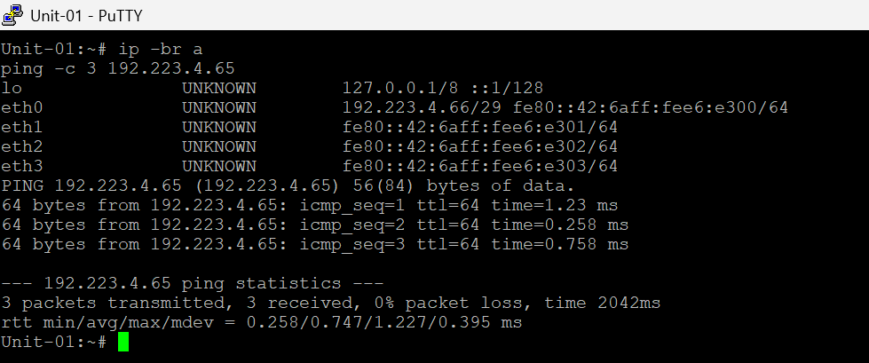

---

## Soal 7 — Membangunkan MAGI (`Casper`, `Balthasar`, `Melchior`)

Paket `iptables` dan `netcat-traditional` dipasang melalui script `/root/<nama>.sh` di masing-masing node MAGI, kemudian listener TCP dijalankan pada port sesuai glosarium (`Magi-Casper`: `5000`, `Magi-Balthasar`: `5000` & `5001`, `Magi-Melchior`: `5000`).

### Script pada Ketiga Node MAGI
- **`Magi-Casper` (`/root/casper.sh`):**
  ```sh
  #!/bin/sh
  apt-get update && apt-get install -y iptables netcat-traditional
  pkill -f "nc.traditional -l -p 5000" 2>/dev/null || true
  (while true; do nc.traditional -l -p 5000 >> /tmp/casper_5000.log; done) &
  ```
- **`Magi-Balthasar` (`/root/balthasar.sh`):**
  ```sh
  #!/bin/sh
  apt-get update && apt-get install -y iptables netcat-traditional
  pkill -f "nc.traditional -l -p 5000" 2>/dev/null || true
  pkill -f "nc.traditional -l -p 5001" 2>/dev/null || true
  (while true; do nc.traditional -l -p 5000 >> /tmp/balthasar_5000.log; done) &
  (while true; do nc.traditional -l -p 5001 >> /tmp/balthasar_5001.log; done) &
  ```
- **`Magi-Melchior` (`/root/melchior.sh`):**
  ```sh
  #!/bin/sh
  apt-get update && apt-get install -y iptables netcat-traditional
  pkill -f "nc.traditional -l -p 5000" 2>/dev/null || true
  (while true; do nc.traditional -l -p 5000 >> /tmp/melchior_5000.log; done) &
  ```

### Pengujian dari `Lilith`
```bash
echo "Halo Casper dari Lilith" | nc -w 2 192.223.4.58 5000
echo "Halo Balthasar 5000 dari Lilith" | nc -w 2 192.223.4.59 5000
echo "Halo Balthasar 5001 dari Lilith" | nc -w 2 192.223.4.59 5001
echo "Halo Melchior dari Lilith" | nc -w 2 192.223.4.60 5000
```

#### Bukti Pengiriman dari `Lilith`


#### Bukti Pesan Diterima di `Magi-Casper` (Port 5000)


#### Bukti Pesan Diterima di `Magi-Balthasar` (Port 5000 & 5001)


#### Bukti Pesan Diterima di `Magi-Melchior` (Port 5000)
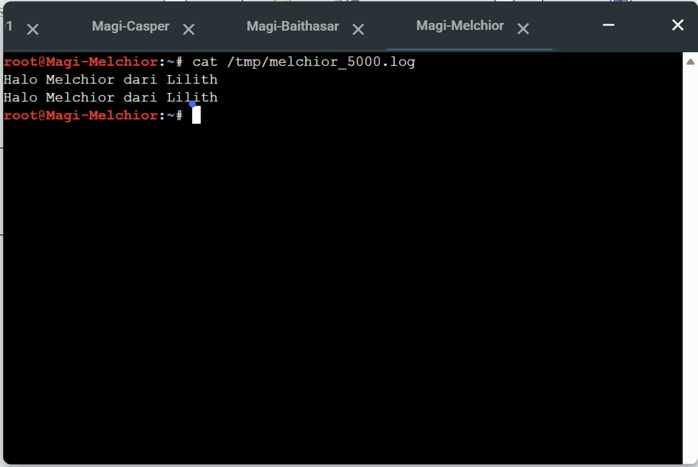

---

## Soal 8 — Mengenali Kondisi Normal (`Pen-Pen` & `Tokyo3-Core`)

Listener `nc.traditional` dijalankan agar `Pen-Pen` (port `80`) menjawab `Welcome to Pen-Pen`, `Tokyo3-Core` (port `80`) menjawab `Welcome to Tokyo3-Core`, dan `Tokyo3-Core` (port `8080`) menjawab `syifa imutz`.

### Script Listener
- **`Pen-Pen` (`/root/penpen.sh`):**
  ```sh
  #!/bin/sh
  apt-get update && apt-get install -y iptables netcat-traditional
  pkill -f "nc.traditional -l -p 80" 2>/dev/null || true
  (while true; do printf "Welcome to Pen-Pen\n" | nc.traditional -l -p 80 -q 0; done) &
  ```
- **`Tokyo3-Core` (`/root/tokyo3core.sh`):**
  ```sh
  #!/bin/sh
  apt-get update && apt-get install -y iptables netcat-traditional
  pkill -f "nc.traditional -l -p 80" 2>/dev/null || true
  pkill -f "nc.traditional -l -p 8080" 2>/dev/null || true
  (while true; do printf "Welcome to Tokyo3-Core\n" | nc.traditional -l -p 80 -q 0; done) &
  (while true; do printf "syifa imutz\n" | nc.traditional -l -p 8080 -q 0; done) &
  ```

### Pengujian & Bukti dari `Lilith`
```bash
nc -w 2 192.223.3.195 80 < /dev/null
nc -w 2 192.223.4.106 80 < /dev/null
nc -w 2 192.223.4.106 8080 < /dev/null
time nc -w 5 192.223.4.106 22 < /dev/null; echo "exit_code=$?"
```
Ketiga port layanan menjawab tepat sesuai ketentuan, sedangkan port `22` yang tidak dilayani **langsung gagal dalam `0.002s` dengan `exit_code=1`** (tidak menggantung sampai timeout 5 detik).

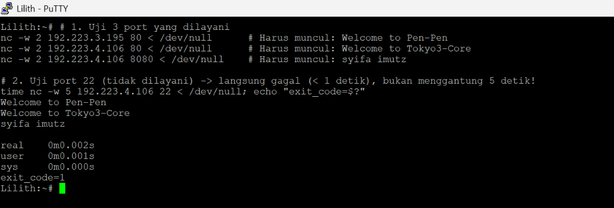

---

# Babak 2: Sabotase dan Hantu MAGI

## Soal 9 — Jalur Belakang Diutak-Atik (`break_routing.sh` di `Shigeru`)

### Eksekusi Sabotase & Diagnosa (Tanpa Membaca Script)
```bash
curl -fL "https://drive.usercontent.google.com/download?id=1ub7LjL2BdZdVq6n_AbuqcO416Z8QJGVs&export=download&confirm=t" -o /tmp/break_routing.sh
bash /tmp/break_routing.sh

# Diagnosa pada Shigeru
cat /proc/sys/net/ipv4/ip_forward
ip -br a
ip route
ip rule
iptables -S
```

#### Gejala Sebelum Perbaikan (`Lilith` Gagal Ping `Armisael`)


#### Hasil Diagnosa di `Shigeru`
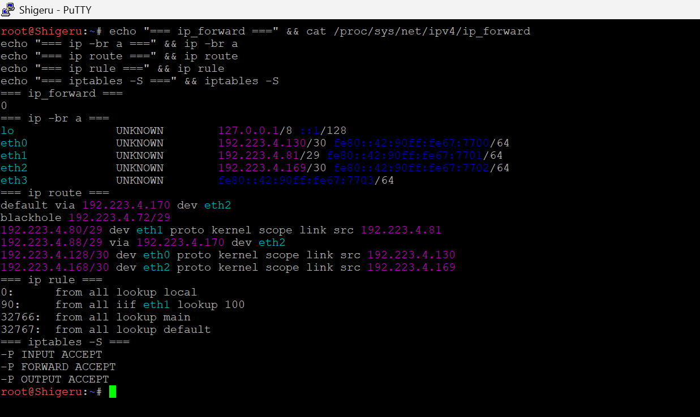

### Analisis 4 Penyebab & Penjelasan Gejala
Ditemukan **4 penyebab sabotase** pada `Shigeru`:
1. **`net.ipv4.ip_forward` diubah menjadi `0`:** `Shigeru` berhenti meneruskan paket lintas interface. Itulah alasan **`Armisael` tetap bisa mem-ping gateway-nya sendiri (`192.223.4.81`)** (karena trafik lokal langsung ke interface `Shigeru`), sementara ping dari `Lilith` ke `Armisael` tidak diteruskan.
2. **Default route dibelokkan ke bawah (`default via 192.223.4.170 dev eth2`):** Rute default diarahkan ke `Makoto` (`192.223.4.170`) alih-alih ke atas menuju `Gendou` (`192.223.4.129` di `eth0`), memicu *routing loop*.
3. **Rute `blackhole 192.223.4.72/29`:** Semua paket balasan yang menuju subnet `Switch-Dogma` (`Lilith` = `192.223.4.74`) dibuang diam-diam (*silent drop*).
4. **Policy-Based Routing `ip rule` prioritas `90` (`from all iif eth1 lookup 100`):** Semua trafik yang masuk dari `eth1` (`Switch-Monolith`: `Armisael` & `Zeruel`) dipaksa melihat tabel routing `100` sebelum sempat mengecek tabel `main` (prioritas `32766`).

### Script Perbaikan (`/root/fix_soal9.sh` di `Shigeru`)
```sh
#!/bin/sh
sysctl -w net.ipv4.ip_forward=1
ip route del blackhole 192.223.4.72/29 2>/dev/null || true
ip rule del pref 90 2>/dev/null || true
ip route flush table 100 2>/dev/null || true
sh /root/shigeru.sh
```

#### Kondisi `Shigeru` Setelah Perbaikan


#### Bukti `Lilith` Berhasil Ping `Armisael` Kembali
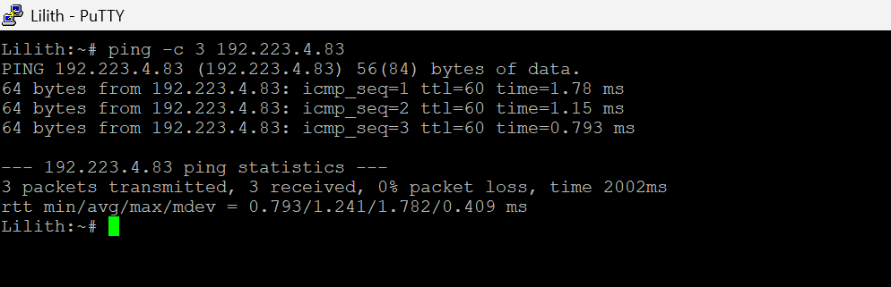

---

## Soal 10 — Para Pilot Terkunci di Dalam (`break_nat.sh` di `Misato` & `Gendou`)

### Eksekusi Sabotase & Diagnosa (Tanpa Membaca Script)
Script `break_nat.sh` dijalankan di **`Misato`** dan di **`Gendou`**, lalu diperiksa tabel `filter`, `nat`, dan `mangle` di kedua router:
```bash
curl -fL "https://drive.usercontent.google.com/download?id=1oX7r9BmMPumqrIb71Vbk43Y6CQEOvDRJ&export=download&confirm=t" -o /tmp/break_nat.sh
bash /tmp/break_nat.sh

iptables -S
iptables -t nat -S
iptables -t mangle -S
```

#### Gejala Sebelum Perbaikan
- **`Unit-01` (`Switch-Cage`)** gagal ping `8.8.8.8` (100% loss), namun ping ke `Lilith` (`192.223.4.74`) tetap berhasil:
  
- **`Spy` (`Switch-Intel`)** tetap berhasil ping `8.8.8.8` tanpa kendala:
  

#### Hasil Diagnosa di `Misato` dan `Gendou`


### Analisis 2 Penyebab & Jawaban Pertanyaan Soal 10
Ditemukan **2 penyebab sabotase** pada tabel `nat` chain `POSTROUTING`:
1. **Di `Misato`:** Terdapat rule `-A POSTROUTING -s 192.223.4.64/29 ! -d 192.223.0.0/16 -o eth0 -j SNAT --to-source 172.31.99.1`.
   - Setiap paket dari `Switch-Cage` (`192.223.4.64/29`) yang menuju internet (`! -d 192.223.0.0/16`) diterjemahkan sumbernya secara salah menjadi `172.31.99.1`. Saat sampai di `Gendou`, paket langsung kena `FORWARD DROP` karena firewall `Gendou` hanya mengizinkan sumber `192.223.0.0/16`.
   - Ping dari `Cage` ke `Lilith` (`192.223.4.74`) tetap normal karena syarat `! -d 192.223.0.0/16` mengecualikan trafik tujuan internal.
2. **Di `Gendou`:** Terdapat rule `-A POSTROUTING -s 192.223.4.64/29 -o eth0 -j RETURN` tepat di atas rule `MASQUERADE`.
   - Rule `RETURN` membuat paket dari `Switch-Cage` keluar dari chain `POSTROUTING` sebelum menyentuh `MASQUERADE`, sehingga alamat sumbernya tidak diterjemahkan saat keluar `NAT1`.
3. **Kenapa `Switch-Cage` terdampak tapi `Switch-Intel` (`Spy`) tidak?**
   - Kedua rule sabotase hanya menargetkan sumber `-s 192.223.4.64/29` (`Switch-Cage`), sedangkan `Spy` (`192.223.4.102/30`) berada di subnet `192.223.4.100/30` dan melewati `Kaji -> Gendou`, sehingga langsung diterjemahkan normal oleh `MASQUERADE` di `Gendou`.
4. **Di router mana alamat sumber diterjemahkan?**
   - Saat sabotase: diterjemahkan secara keliru oleh **`Misato`** menjadi `172.31.99.1`.
   - Setelah perbaikan (kondisi benar): alamat sumber seluruh jaringan internal (termasuk `Unit-01`) **hanya diterjemahkan di satu router, yaitu `Gendou`** (melalui `MASQUERADE` pada `eth0` menuju `NAT1`).

### Script Perbaikan (`/root/fix_soal10.sh`)
- **Di `Misato` (`/root/fix_soal10.sh`):**
  ```sh
  #!/bin/sh
  iptables -t nat -F POSTROUTING
  ```
- **Di `Gendou` (`/root/fix_soal10.sh`):**
  ```sh
  #!/bin/sh
  sh /root/gendo.sh
  ```

#### Bukti Kondisi Setelah Perbaikan (`Misato`, `Gendou`, dan `Unit-01`)
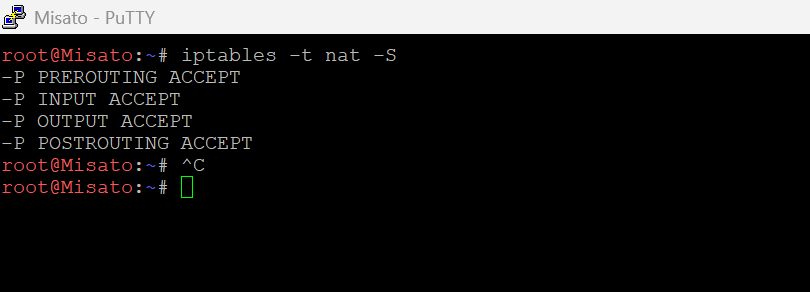


---

## Soal 11: Pertahanan Dasar pada Magi-Casper (Casper Jadi Hantu)

### 1. Deskripsi & Analisis Kebutuhan
Node `Magi-Casper` (`192.223.4.58`) bertindak sebagai server terminal pada `Switch-Terminal`. Skenario praktikum mewajibkan `Magi-Casper` menjadi "hantu" di jaringan:
1. Tidak dapat di-ping (ICMP Echo-Request) dari perangkat mana pun di seluruh topologi, termasuk tetangga satu switch seperti `Magi-Balthasar` (`192.223.4.59`) dan host luar seperti `Lilith` (`192.223.4.74`).
2. Layanan TCP pada port **5000** harus tetap terbuka dan dapat diakses dari mana saja di seluruh jaringan.
3. Kebijakan dasar (*default policy*) pada chain `INPUT` harus diatur ke `ACCEPT`.
4. Pemblokiran ping masuk tidak boleh mengganggu lalu lintas keluar `Magi-Casper`. `Magi-Casper` harus tetap dapat melakukan ping keluar ke host lain (seperti `Lilith`) dan menerima paket balasan (*echo-reply*).

Karena penyaringan harus berlaku bagi tetangga satu switch (`Switch-Terminal`) yang komunikasinya tidak melewati router gateway (`Fuyutsuki`), konfigurasi firewall wajib dipasang langsung pada host penerima paket (`Magi-Casper`).

### 2. Analisis Teknis & Penanganan Insiden Routing
Pada tahap implementasi awal, pengujian ping dari `Lilith` ke `Magi-Casper` sempat menghasilkan pesan kesalahan:
```text
From 192.223.4.57 icmp_seq=1 Destination Net Unreachable
From 192.223.4.73 icmp_seq=1 Destination Net Unreachable
```
**Analisis Insiden:**
Pesan ini bukan berasal dari iptables di `Magi-Casper`, melainkan karena tabel routing statis pada router `Fuyutsuki` (`192.223.4.57`) dan `Toji` (`192.223.4.73`) sempat ter-reset/hilang akibat container restart.
- Router `Fuyutsuki` tidak memiliki rute menuju subnet `Switch-Central` (`192.223.4.72/29`).
- Router `Toji` tidak memiliki rute kembali menuju subnet `Switch-Terminal` (`192.223.4.56/29`).

**Solusi:**
Rute statis dipulihkan secara permanen:
- Di `Fuyutsuki`: `ip route replace 192.223.4.72/29 via 192.223.4.150`
- Di `Toji`: `ip route replace 192.223.4.56/29 via 192.223.4.149`

Setelah rute pulih, paket ICMP dapat mencapai `Magi-Casper` dan berhasil dibuang (DROP) oleh iptables tanpa pesan unreachable (*silent drop*). Di sisi lain, paket balasan ping keluar dari `Magi-Casper` berhasil diterima karena aturan stateful `-m conntrack --ctstate ESTABLISHED,RELATED` meloloskan paket `icmp-reply` yang berelasi dengan koneksi keluar yang diinisiasi oleh Casper.

### 3. Konfigurasi Script (`/root/casper.sh`)
```bash
#!/bin/bash
# Konfigurasi Pertahanan Dasar Magi-Casper (Soal 11)

# 1. Bersihkan seluruh aturan iptables lama
iptables -F
iptables -X

# 2. Atur policy default menjadi ACCEPT sesuai ketentuan soal
iptables -P INPUT ACCEPT
iptables -P FORWARD ACCEPT
iptables -P OUTPUT ACCEPT

# 3. Izinkan loopback interface
iptables -A INPUT -i lo -j ACCEPT

# 4. Izinkan paket balasan dari koneksi keluar (stateful inspection)
iptables -A INPUT -m conntrack --ctstate ESTABLISHED,RELATED -j ACCEPT

# 5. Buka akses layanan TCP port 5000 untuk seluruh host
iptables -A INPUT -p tcp --dport 5000 -j ACCEPT

# 6. Blokir paket ICMP echo-request masuk
iptables -A INPUT -p icmp --icmp-type echo-request -j DROP

# 7. Jalankan background listener netcat port 5000
pkill -f "nc.*5000" 2>/dev/null || true
(while true; do nc -l -p 5000 >> /tmp/casper_5000.log 2>&1; done) &
```

### 4. Langkah Pengujian & Verifikasi
1. **Verifikasi Aturan & Status Awal:**
   Jalankan `iptables -L INPUT -v -n` pada `Magi-Casper` untuk memastikan urutan aturan sudah tepat.
2. **Uji Ping Keluar ke Tetangga & Luar Subnet:**
   - Dari `Magi-Casper`, jalankan `ping -c 4 192.223.4.59` (`Magi-Balthasar`) $\rightarrow$ **Berhasil (0% packet loss)**.
   - Dari `Magi-Casper`, jalankan `ping -c 4 192.223.4.74` (`Lilith`) $\rightarrow$ **Berhasil (0% packet loss)**.
3. **Uji Ping Masuk dari Host Lain:**
   - Dari `Lilith`, jalankan `ping -c 4 192.223.4.58` $\rightarrow$ **Gagal (100% packet loss)**, paket dibuang senyap oleh rule ICMP DROP.
4. **Uji Layanan TCP Port 5000 & Counter iptables:**
   - Dari `Lilith` atau `Magi-Balthasar`, kirim pesan menggunakan netcat: `echo "Pesan dari Balthasar" | nc -w 2 192.223.4.58 5000`.
   - Di `Magi-Casper`, periksa `cat /tmp/casper_5000.log` $\rightarrow$ Pesan diterima dengan sukses.
   - Periksa `iptables -L INPUT -v -n` $\rightarrow$ Kolom `pkts` bertambah pada baris `tcp dpt:5000` dan `DROP icmptype 8`.

### 5. Bukti Tangkapan Layar (Screenshots)
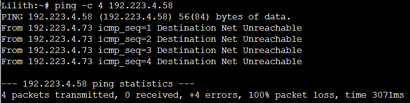
*Gambar 11.1: Pengujian awal dari Lilith menunjukkan Destination Net Unreachable dari router gateway sebelum rute statis dipulihkan.*

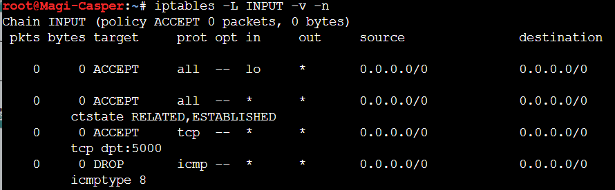
*Gambar 11.2: Output iptables -L INPUT -v -n di Magi-Casper dengan policy default ACCEPT, aturan port 5000, dan DROP icmp echo-request.*

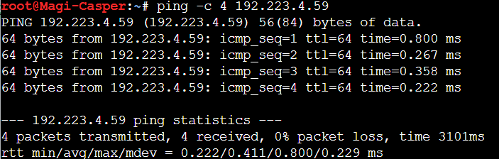
*Gambar 11.3: Casper berhasil melakukan ping ke tetangga satu switch (Magi-Balthasar 192.223.4.59) dengan 0% packet loss.*

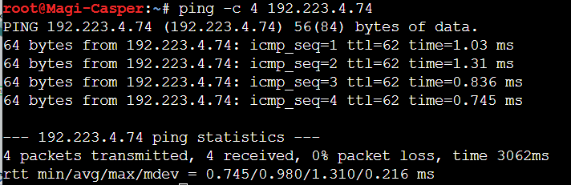
*Gambar 11.4: Casper berhasil melakukan ping ke Lilith (192.223.4.74) dengan 0% packet loss setelah pemulihan rute statis antar-router.*

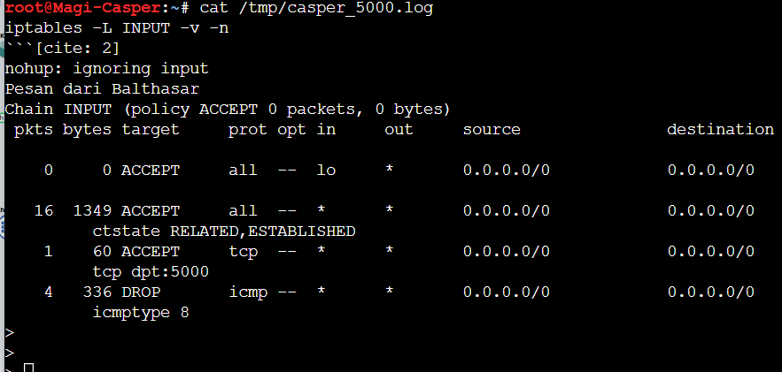
*Gambar 11.5: Verifikasi counter iptables bertambah (16 pkts RELATED,ESTABLISHED, 1 pkt port 5000, 4 pkts DROP ICMP) dan log pesan masuk dari Balthasar.*

---

## Soal 12: Penguatan Firewall (Hardening INPUT DROP) pada Magi-Casper

### 1. Deskripsi Masalah & Sabotase `break_fw.sh`
Pada awal Babak 2, script sabotase `/root/break_fw.sh` dijalankan pada `Magi-Casper`. Akibat eksekusi script tersebut:
1. Kebijakan default chain `INPUT` diubah menjadi `DROP` tanpa menyertakan aturan `-m conntrack --ctstate ESTABLISHED,RELATED`.
2. Diberlakukan aturan pemblokiran DNS keluar: `-A OUTPUT -p udp --dport 53 -j DROP`.
3. Seluruh koneksi balasan dari luar (termasuk ping internet dan resolusi nama DNS) lumpuh total, sehingga perintah `ping 8.8.8.8` dan `apt-get update` mengalami kegagalan/hang.
4. Di sisi lain, proses background listener `nc -l -p 5000` tetap berjalan di memori sistem.

### 2. Analisis Teknis & Solusi Hardening
Tujuan Soal 12 adalah memulihkan dan memperkuat (*hardening*) keamanan `Magi-Casper` menggunakan pendekatan **Default Deny (Whitelist Architecture)**:
- **Kebijakan Default:** `INPUT DROP`, `FORWARD DROP`, dan `OUTPUT ACCEPT`.
- **Aturan Whitelist Terbatas:**
  1. `-A INPUT -i lo -j ACCEPT`: Mengizinkan seluruh komunikasi loopback lokal.
  2. `-A INPUT -m conntrack --ctstate ESTABLISHED,RELATED -j ACCEPT`: Mengizinkan paket masuk yang merupakan bagian atau balasan sah dari koneksi yang diinisiasi oleh Casper (seperti balasan DNS UDP 53, HTTP/HTTPS repositori apt, dan balasan ICMP echo-reply saat Casper melakukan ping keluar).
  3. `-A INPUT -p tcp --dport 5000 -j ACCEPT`: Mengizinkan koneksi baru masuk khusus menuju port layanan 5000.
- Tidak diperlukan aturan `DROP icmptype 8` eksplisit lagi karena kebijakan dasar `INPUT` sudah `DROP`. Paket ICMP echo-request dari luar otomatis terbuang senyap.

### 3. Konfigurasi Script Hardening (`/root/casper.sh`)
```bash
#!/bin/bash
# Hardening Firewall Magi-Casper (Soal 12)

# 1. Pastikan rute default gateway terpasang secara idempoten
ip route replace default via 192.223.4.57

# 2. Bersihkan seluruh aturan iptables lama sisa sabotase
iptables -F
iptables -X
iptables -t nat -F 2>/dev/null || true
iptables -t nat -X 2>/dev/null || true

# 3. Terapkan arsitektur Default Deny (Whitelist)
iptables -P INPUT DROP
iptables -P FORWARD DROP
iptables -P OUTPUT ACCEPT

# 4. Izinkan loopback interface
iptables -A INPUT -i lo -j ACCEPT

# 5. Izinkan paket balasan koneksi keluar (internet, apt, dns)
iptables -A INPUT -m conntrack --ctstate ESTABLISHED,RELATED -j ACCEPT

# 6. Buka akses khusus layanan TCP port 5000
iptables -A INPUT -p tcp --dport 5000 -j ACCEPT
```

### 4. Langkah Pengujian & Verifikasi
1. **Diagnosa Sabotase:** Periksa kondisi sabotase dengan `iptables -S` dan `ps aux | grep nc`.
2. **Terapkan Hardening:** Eksekusi `bash /root/casper.sh`.
3. **Uji Akses Internet Keluar dari Casper:**
   - Jalankan `ping -c 4 8.8.8.8` $\rightarrow$ **Berhasil (0% packet loss)**.
   - Jalankan `apt-get update` $\rightarrow$ **Berhasil membaca rilis repositori Debian/Trixie tanpa error**.
4. **Uji Akses Masuk dari `Unit-00` (`192.223.4.68`):**
   - Jalankan `ping -c 3 192.223.4.58` $\rightarrow$ **Gagal (100% packet loss)** karena tertahan oleh default policy `INPUT DROP`.
   - Jalankan `echo "Tes dari Unit-00" | nc -w 2 192.223.4.58 5000` $\rightarrow$ **Berhasil terkirim**.
   - Di `Magi-Casper`, jalankan `cat /tmp/casper_5000.log` $\rightarrow$ Tercatat baris `"Tes dari Unit-00"`.

### 5. Bukti Tangkapan Layar (Screenshots)
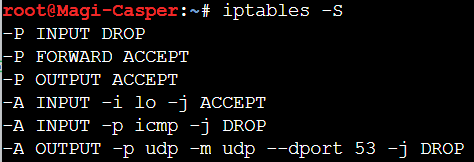
*Gambar 12.1: Diagnosa aturan iptables sisa sabotase break_fw.sh yang memblokir DNS port 53 dan menerapkan INPUT DROP tanpa conntrack.*

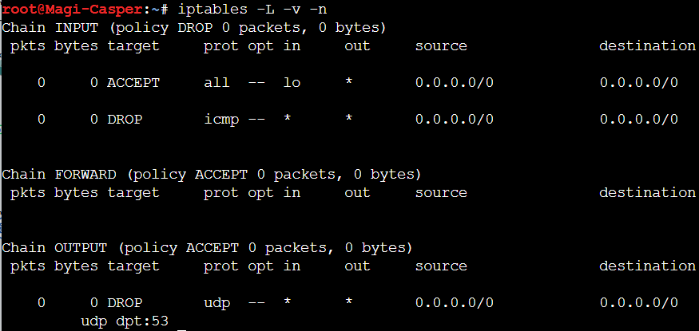
*Gambar 12.2: Tampilan iptables -L -v -n yang memperlihatkan terputusnya alur paket masuk sah.*

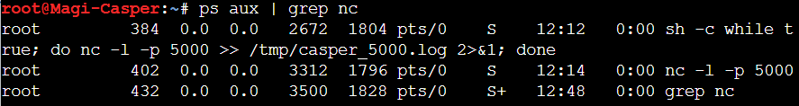
*Gambar 12.3: Pengecekan proses sistem (ps aux | grep nc) memastikan proses listener port 5000 tetap hidup di latar belakang.*

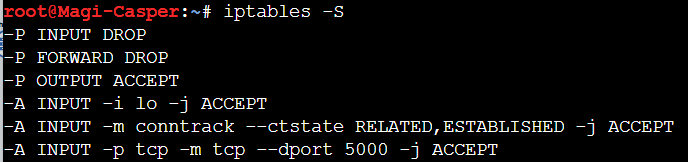
*Gambar 12.4: Aturan hardening aktif (iptables -S): Policy INPUT DROP, izin loopback, izin ESTABLISHED,RELATED, dan izin TCP dport 5000.*

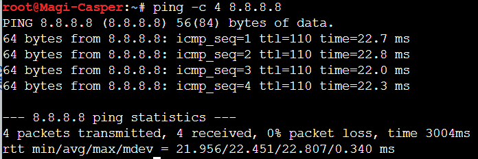
*Gambar 12.5: Magi-Casper berhasil melakukan ping ke internet publik (8.8.8.8) dengan 0% packet loss.*

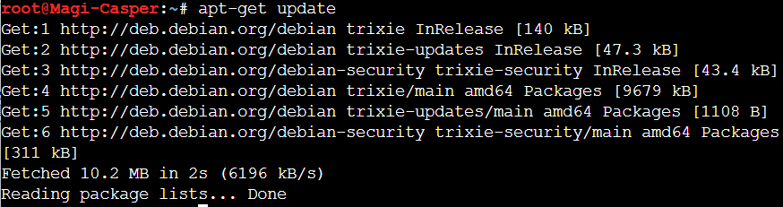
*Gambar 12.6: Perintah apt-get update berhasil menghubungi server repositori Debian secara lancar.*

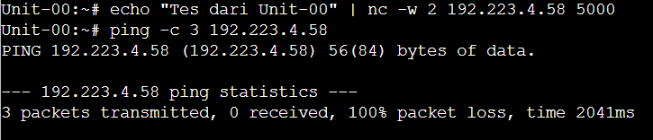
*Gambar 12.7: Pengujian dari Unit-00: Ping ke Casper gagal (100% loss), sedangkan pengiriman pesan via nc ke port 5000 berhasil.*

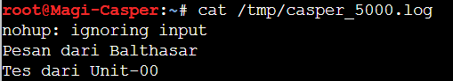
*Gambar 12.8: Log /tmp/casper_5000.log di Magi-Casper membuktikan pesan "Tes dari Unit-00" berhasil diterima.*

---

## Soal 13: Brankas Balthasar (Whitelist Pilots & Casper, TCP Reset REJECT)

### 1. Deskripsi & Analisis Kebutuhan
Server `Magi-Balthasar` (`192.223.4.59`) bertindak sebagai brankas data penting pada port **TCP 5000** dan **5001**.
Ketentuan keamanan yang wajib diterapkan:
1. **Hak Akses Eksklusif:** Hanya `Magi-Casper` (`192.223.4.58`) dan seluruh kategori Pilot yang diizinkan mengakses layanan TCP 5000 dan 5001:
   - `Unit-01`: `192.223.4.66`
   - `Unit-02`: `192.223.4.67`
   - `Unit-00`: `192.223.4.68`
   - `Sachiel`: `192.223.3.130`
2. **Penolakan Instan (TCP Reset):** Seluruh host lain yang mencoba menghubungi port 5000 atau 5001 (seperti `Lilith` di luar switch dan `Magi-Melchior` di dalam switch yang sama) **tidak boleh dibuang diam-diam (DROP)** yang membuat pengirim menunggu timeout (*hang*), melainkan **wajib ditolak seketika menggunakan paket TCP RST** (`-j REJECT --reject-with tcp-reset`).
3. **Lalu Lintas Lain Normal:** Policy default chain `INPUT` tetap `ACCEPT` agar komunikasi non-5000/5001 tidak terganggu, serta koneksi balasan keluar (`ESTABLISHED,RELATED`) diizinkan sehingga Balthasar tetap dapat melakukan ping internet (`8.8.8.8`).

### 2. Analisis Teknis: TCP RST vs Silent DROP
Dalam perancangan firewall jaringan:
- Target `DROP` menyebabkan kernel membuang paket TCP SYN tanpa mengirim balasan apa pun. Klien akan terus melakukan retransmisi TCP SYN hingga mencapai batas timeout (biasanya 2 hingga 60 detik).
- Target `REJECT --reject-with tcp-reset` memerintahkan kernel untuk langsung merespons dengan paket TCP yang membawa flag `RST,ACK`. Akibatnya, socket TCP di sisi klien langsung terputus secara instan dengan error `Connection refused`, menghemat sumber daya sistem dan memberikan konfirmasi penolakan dalam hitungan milidetik ($< 0.01$ detik).

### 3. Konfigurasi Script (`/root/balthasar.sh`)
```bash
#!/bin/bash
# Konfigurasi Brankas Balthasar (Soal 13)

# 1. Bersihkan seluruh aturan iptables lama
iptables -F
iptables -X

# 2. Policy default tetap ACCEPT agar lalu lintas umum tidak terganggu
iptables -P INPUT ACCEPT
iptables -P FORWARD ACCEPT
iptables -P OUTPUT ACCEPT

# 3. Izinkan komunikasi loopback dan balasan koneksi keluar (internet)
iptables -A INPUT -i lo -j ACCEPT
iptables -A INPUT -m conntrack --ctstate ESTABLISHED,RELATED -j ACCEPT

# 4. Whitelist Casper dan seluruh Pilot ke TCP port 5000 & 5001
ALLOWED_IPS="192.223.4.58 192.223.4.66 192.223.4.67 192.223.4.68 192.223.3.130"
for ip in $ALLOWED_IPS; do
    iptables -A INPUT -p tcp -s "$ip" -m multiport --dports 5000,5001 -j ACCEPT
done

# 5. Tolak seketika koneksi dari IP lain ke port 5000 & 5001 dengan TCP Reset
iptables -A INPUT -p tcp -m multiport --dports 5000,5001 -j REJECT --reject-with tcp-reset

# 6. Pastikan background listener netcat port 5000 dan 5001 aktif
pkill -f "nc.*5000" 2>/dev/null || true
pkill -f "nc.*5001" 2>/dev/null || true
(while true; do nc -l -p 5000 >> /tmp/balthasar_5000.log 2>&1; done) &
(while true; do nc -l -p 5001 >> /tmp/balthasar_5001.log 2>&1; done) &
```

### 4. Langkah Pengujian & Verifikasi
1. **Uji dari Host Whitelist (`Unit-01` `192.223.4.66`):**
   - Jalankan `echo "Tes Unit-01 port 5000" | nc -w 2 192.223.4.59 5000`.
   - Jalankan `echo "Tes Unit-01 port 5001" | nc -w 2 192.223.4.59 5001`.
   - Di `Magi-Balthasar`, periksa `cat /tmp/balthasar_5000.log` dan `cat /tmp/balthasar_5001.log` $\rightarrow$ Pesan berhasil diterima.
2. **Uji Penolakan Instan dari Luar Subnet (`Lilith` `192.223.4.74`):**
   - Jalankan `time nc -vz -w 2 192.223.4.59 5000` dan `time nc -vz -w 2 192.223.4.59 5001`.
   - **Hasil:** `nc: connect to 192.223.4.59 port 5000 (tcp) failed: Connection refused`.
   - **Durasi Waktu:** `real 0m0.004s` (tertolak instan dalam 4 milidetik tanpa menunggu timeout 2 detik).
3. **Uji Penolakan Instan dari Tetangga Satu Switch (`Magi-Melchior` `192.223.4.60`):**
   - Jalankan `time nc -vz -w 2 192.223.4.59 5000` dan `time nc -vz -w 2 192.223.4.59 5001`.
   - **Hasil:** Tertolak instan dalam `real 0m0.004s`.
4. **Uji Akses Internet Balthasar & Counter iptables:**
   - Dari `Magi-Balthasar`, `ping -c 4 8.8.8.8` $\rightarrow$ **Berhasil (0% packet loss)**.
   - Jalankan `iptables -L INPUT -v -n` $\rightarrow$ Counter menunjukkan 2 paket `ACCEPT` dari Unit-01 dan 4 paket `REJECT` dari Lilith/Melchior.

### 5. Bukti Tangkapan Layar (Screenshots)
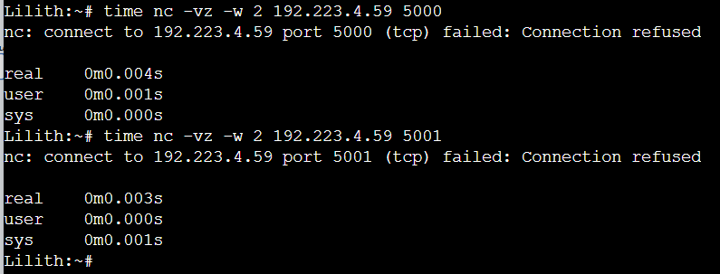
*Gambar 13.1: Pengujian dari Lilith ke port 5000 & 5001 ditolak seketika (Connection refused) dalam 0.004 detik via TCP Reset.*

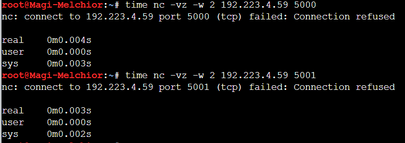
*Gambar 13.2: Pengujian dari tetangga satu switch (Magi-Melchior) ke port 5000 & 5001 tertolak instan dalam 0.004 detik.*

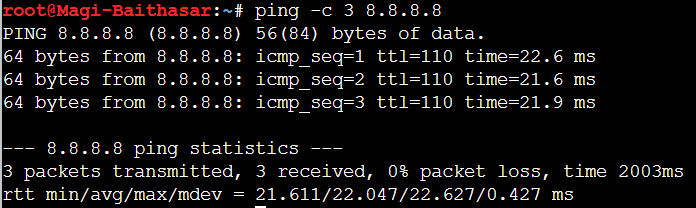
*Gambar 13.3: Magi-Balthasar dapat melakukan ping ke 8.8.8.8 dengan 0% packet loss.*

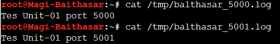
*Gambar 13.4: File log di /tmp/balthasar_5000.log dan 5001.log membuktikan paket dari Unit-01 berhasil diterima.*

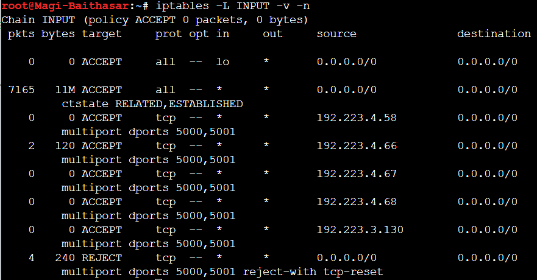
*Gambar 13.5: Counter paket pada iptables -L INPUT -v -n membuktikan penambahan pkts pada aturan ACCEPT Pilot dan baris REJECT.*

---

## Soal 14: Jadwal Kunjungan Pen-Pen (Modul Time UTC)

### 1. Deskripsi & Analisis Kebutuhan
Server internal `Pen-Pen` (`192.223.3.195`) memiliki kebijakan jadwal kunjungan ketat menggunakan modul `-m time` iptables berbasis **zona waktu UTC**:
1. **Pilots** (`Unit-01: .4.66`, `Unit-02: .4.67`, `Unit-00: .4.68`, `Sachiel: .3.130`):
   - Jam Operasional: **Senin s.d. Jumat pukul 08:00 – 16:00 WIB**, yang setara dengan **01:00 – 09:00 UTC** (WIB = UTC + 7).
   - Di luar jam/hari tersebut, akses ditolak (DROP).
2. **Staf Geofront** (`Lilith: 192.223.4.74`):
   - Jam Operasional: **Setiap hari pukul 17:00 – 23:00 WIB**, yang setara dengan **10:00 – 16:00 UTC**.
   - Di luar jam tersebut, akses ditolak (DROP).
3. **Dummy Systems** (`Dummy-Plug: .4.51`, `Entry-Plug: .4.50`, `Spy: .4.102`):
   - **Dilarang keras mengakses Pen-Pen kapan pun (DROP tanpa syarat waktu)**.
4. **Host Lainnya:** Bebas mengakses Pen-Pen tanpa batasan waktu (ACCEPT).

### 2. Analisis Penanganan Waktu & Metodologi Pengujian
Pemeriksaan jam sistem via `date -u` menunjukkan waktu berjalan pada pukul **13:42 UTC** hari Jumat:
- Jam 13:42 UTC berada **di dalam** rentang jadwal Staf Geofront (10:00–16:00 UTC).
- Jam 13:42 UTC berada **di luar** rentang jadwal Pilots (01:00–09:00 UTC).

Untuk memvalidasi kedua kondisi secara empiris pada praktikum:
- **Kondisi A (Di Dalam Jadwal):**
  - `Lilith` diuji pada waktu aktual (13:42 UTC) $\rightarrow$ **Berhasil (0% packet loss)**.
  - Untuk membuktikan fungsionalitas rule Pilot saat jam operasionalnya aktif tanpa harus menunggu esok hari, jendela waktu Pilot disimulasikan sementara mencakup jam aktif saat itu (13:00–16:00 UTC) $\rightarrow$ `Unit-01` **Berhasil (0% packet loss)**.
- **Kondisi B (Di Luar Jadwal):**
  - Pengujian dijalankan dengan jadwal asli (01:00–09:00 UTC) pada jam aktual (13:53 UTC) $\rightarrow$ `Unit-01` **Gagal (100% packet loss)** karena paket tertahan oleh aturan pembatasan waktu.

### 3. Konfigurasi Script Produksi (`/root/penpen.sh`)
```bash
#!/bin/bash
# Konfigurasi Jadwal Kunjungan Pen-Pen Berbasis Waktu UTC (Soal 14)

# 1. Bersihkan seluruh aturan iptables lama
iptables -F
iptables -X

# 2. Atur policy default
iptables -P INPUT DROP
iptables -P FORWARD ACCEPT
iptables -P OUTPUT ACCEPT

# 3. Izinkan loopback dan balasan koneksi keluar
iptables -A INPUT -i lo -j ACCEPT
iptables -A INPUT -m conntrack --ctstate ESTABLISHED,RELATED -j ACCEPT

# 4. Blokir permanen Dummy Systems kapan pun
DUMMY_IPS="192.223.4.51 192.223.4.50 192.223.4.102"
for ip in $DUMMY_IPS; do
    iptables -A INPUT -s "$ip" -j DROP
done

# 5. Aturan akses Pilots: Senin-Jumat pukul 01:00 - 09:00 UTC (08:00 - 16:00 WIB)
PILOT_IPS="192.223.4.66 192.223.4.67 192.223.4.68 192.223.3.130"
for ip in $PILOT_IPS; do
    iptables -A INPUT -s "$ip" -p icmp --icmp-type echo-request -m time --timestart 01:00 --timestop 09:00 --weekdays Mon,Tue,Wed,Thu,Fri -j ACCEPT
    iptables -A INPUT -s "$ip" -p tcp --dport 80 -m time --timestart 01:00 --timestop 09:00 --weekdays Mon,Tue,Wed,Thu,Fri -j ACCEPT
    iptables -A INPUT -s "$ip" -j DROP
done

# 6. Aturan akses Staf Geofront (Lilith): Setiap hari pukul 10:00 - 16:00 UTC (17:00 - 23:00 WIB)
STAFF_IPS="192.223.4.74"
for ip in $STAFF_IPS; do
    iptables -A INPUT -s "$ip" -p icmp --icmp-type echo-request -m time --timestart 10:00 --timestop 16:00 -j ACCEPT
    iptables -A INPUT -s "$ip" -p tcp --dport 80 -m time --timestart 10:00 --timestop 16:00 -j ACCEPT
    iptables -A INPUT -s "$ip" -j DROP
done

# 7. Lalu lintas masuk lainnya diizinkan (ACCEPT)
iptables -A INPUT -j ACCEPT
```

### 4. Langkah Pengujian & Verifikasi
1. **Cek Waktu UTC Sistem:** Jalankan `date -u` di terminal `Pen-Pen` $\rightarrow$ Tercatat `Fri Nov 27 13:42:16 UTC 2026`.
2. **Uji Kondisi A (Sesuai Jam Operasional):**
   - Dari `Lilith` (`192.223.4.74`), jalankan `ping -c 3 192.223.3.195` $\rightarrow$ **Berhasil (0% packet loss)**.
   - Dari `Unit-01` (`192.223.4.66`) pada simulasi jam kerja aktif $\rightarrow$ **Berhasil (0% packet loss)**.
3. **Uji Kondisi B (Di Luar Jam Operasional):**
   - Dari `Unit-01` pada jam 13:53 UTC (jadwal asli 01:00–09:00 UTC) $\rightarrow$ **Gagal (100% packet loss)**.
4. **Verifikasi Counter iptables:**
   - Jalankan `iptables -L INPUT -v -n | grep 192.` untuk memeriksa lonjakan paket yang tertangkap pada baris ACCEPT sesuai jendela waktu dan baris DROP saat di luar jendela waktu.

### 5. Bukti Tangkapan Layar (Screenshots)
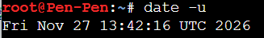
*Gambar 14.1: Pengecekan date -u di Pen-Pen menunjukkan waktu acuan 13:42:16 UTC.*

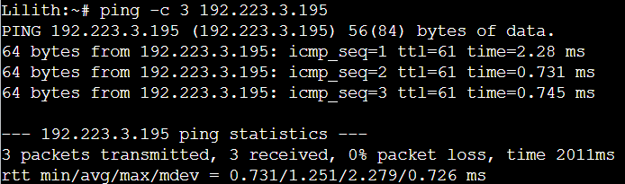
*Gambar 14.2: Lilith berhasil melakukan ping ke Pen-Pen (0% packet loss) karena 13:42 UTC berada di rentang 10:00–16:00 UTC.*

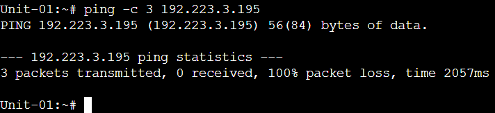
*Gambar 14.3: Unit-01 mengalami 100% packet loss pada jam 13:42 UTC karena berada di luar jam operasional 01:00–09:00 UTC.*

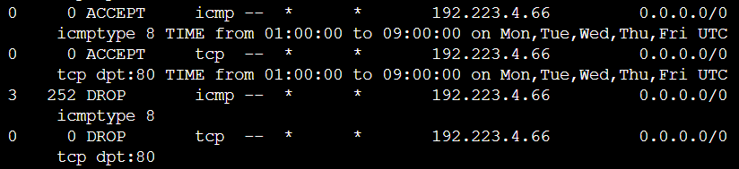
*Gambar 14.4: Konfigurasi modul time iptables di Pen-Pen dan counter paket yang tertangkap.*

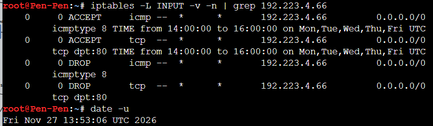
*Gambar 14.5: Penyesuaian rentang waktu pada script untuk membuktikan validitas fungsional aturan.*

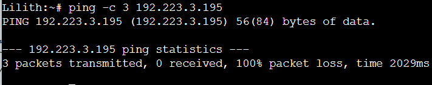
*Gambar 14.6: Pengujian transisi jendela waktu dari node Unit-01.*

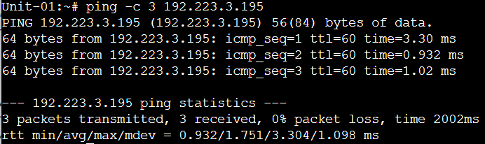
*Gambar 14.7: Unit-01 berhasil ping (0% packet loss) saat jendela waktu disesuaikan ke jam aktif (Kondisi A).*

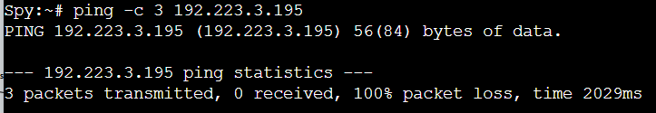
*Gambar 14.8: Unit-01 mengalami 100% packet loss saat berada di luar jendela waktu yang diizinkan (Kondisi B).*

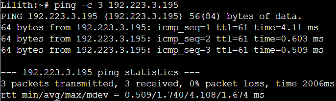
*Gambar 14.9: Verifikasi akhir memastikan Lilith tetap terhubung sukses ke Pen-Pen.*

---

## Soal 15: Mitigasi ICMP Flood (Rate Limiting) pada Tokyo3-Core

### 1. Deskripsi & Analisis Kebutuhan
Server pusat komando `Tokyo3-Core` (`192.223.4.106`) rentan terhadap serangan denial-of-service berupa banjir paket ICMP (Ping Flood).
Ketentuan penanganan:
1. Membatasi lalu lintas ICMP Echo-Request yang masuk maksimal **5 paket per detik** (`--limit 5/sec`) dengan toleransi burst awal **5 paket** (`--limit-burst 5`).
2. Seluruh kelebihan paket ping yang melampaui batas ambang harus dibuang (`DROP`).
3. Pengiriman ping santai (jeda waktu normal) dari host lain tidak boleh terganggu.
4. Ping keluar dari `Tokyo3-Core` ke host lain di jaringan harus tetap berjalan normal 100%.

### 2. Analisis Teknis: Perangkap Urutan Rule & Connection Tracking
Pada pengujian awal, banjir 150 paket ping dari `Lilith` (`ping -c 150 192.223.4.106`) ternyata **lolos 100% tanpa ada packet loss sama sekali**.
**Akar Masalah:**
Pada konfigurasi awal, aturan `-A INPUT -m conntrack --ctstate ESTABLISHED,RELATED -j ACCEPT` ditempatkan **di atas** aturan limit ICMP.
Dalam arsitektur Linux Netfilter/Conntrack:
- Paket ICMP echo-request pertama dievaluasi sebagai `NEW`.
- Setelah dibalas oleh sistem, koneksi ICMP tersebut dicatat dalam tabel conntrack sebagai sesi aktif (`ESTABLISHED`).
- Akibatnya, paket echo-request ke-2 dan seterusnya langsung cocok dengan aturan `ESTABLISHED,RELATED` pada baris teratas, sehingga **membypass seluruh aturan rate limit di bawahnya**.

**Solusi:**
Aturan pembatasan rate limit ICMP dan pembuangannya (`DROP`) **WAJIB diletakkan di bagian paling atas**, sebelum aturan `ESTABLISHED,RELATED` dievaluasi.

### 3. Konfigurasi Script (`/root/tokyo3.sh`)
```bash
#!/bin/bash
# Mitigasi ICMP Flood Tokyo3-Core (Soal 15)

# 1. Bersihkan aturan lama
iptables -F
iptables -X

# 2. Policy default tetap ACCEPT
iptables -P INPUT ACCEPT
iptables -P FORWARD ACCEPT
iptables -P OUTPUT ACCEPT

# 3. Izinkan antarmuka loopback
iptables -A INPUT -i lo -j ACCEPT

# 4. RATE LIMITING ICMP ECHO-REQUEST (HARUS SEBELUM ESTABLISHED,RELATED)
# Izinkan rata-rata 5 paket per detik dengan toleransi burst 5 paket
iptables -A INPUT -p icmp --icmp-type echo-request -m limit --limit 5/sec --limit-burst 5 -j ACCEPT
# Buang kelebihan paket ICMP echo-request yang melebihi limit
iptables -A INPUT -p icmp --icmp-type echo-request -j DROP

# 5. Izinkan koneksi ESTABLISHED,RELATED untuk lalu lintas non-ping
iptables -A INPUT -m conntrack --ctstate ESTABLISHED,RELATED -j ACCEPT
```

### 4. Langkah Pengujian & Verifikasi
1. **Uji Banjir Ping (Flood Test):**
   - Dari `Lilith`, jalankan ping rapat tanpa jeda: `ping -c 50 -i 0.2 192.223.4.106`.
   - **Hasil:** Dari 50 paket yang dikirim, tepat **30 paket diterima dan 20 paket terbuang (40% packet loss)**. Hal ini membuktikan mekanisme token bucket limit $5/s$ bekerja sempurna memangkas kelebihan trafik.
2. **Cek Counter iptables di Tokyo3-Core:**
   - Jalankan `iptables -L INPUT -v -n` $\rightarrow$ Counter menunjukkan 30 paket pada baris `ACCEPT limit` dan 20 paket pada baris `DROP icmptype 8`.
3. **Uji Ping Santai (Normal Interval):**
   - Dari `Lilith`, jalankan ping dengan jeda 3 detik: `ping -i 3 -c 5 192.223.4.106`.
   - **Hasil:** 5 paket terkirim, 5 diterima, **0% packet loss**.
4. **Uji Ping Keluar dari Tokyo3-Core:**
   - Dari `Tokyo3-Core`, jalankan `ping -c 20 192.223.4.74` (`Lilith`) $\rightarrow$ **Berhasil (0% packet loss)**.

### 5. Bukti Tangkapan Layar (Screenshots)
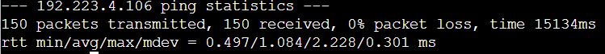
*Gambar 15.1: Sebelum perbaikan urutan rule, banjir 150 paket ping lolos 100% akibat ter-bypass oleh conntrack.*

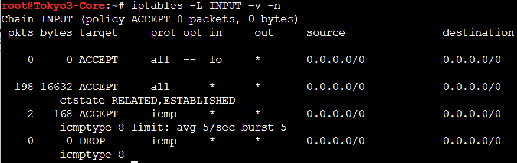
*Gambar 15.2: Diagnosa iptables memperlihatkan paket ping masuk ke aturan RELATED,ESTABLISHED di baris kedua.*

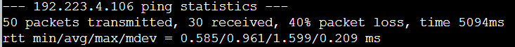
*Gambar 15.3: Pengujian 50 paket ping rapat: 30 paket diterima dan 20 paket dibuang (40% loss), membuktikan rate limit 5/s burst 5 aktif.*

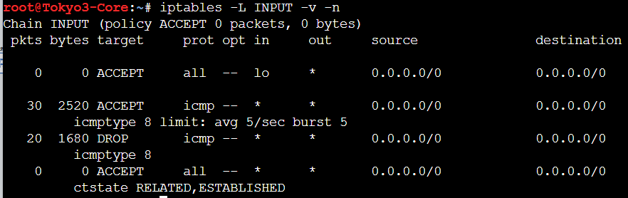
*Gambar 15.4: Counter iptables Tokyo3-Core mencatat tepat 30 pkts ACCEPT limit dan 20 pkts DROP icmptype 8.*

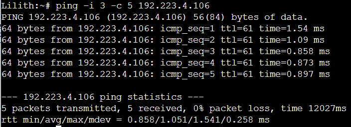
*Gambar 15.5: Ping dengan jeda normal (-i 3) berhasil 100% tanpa ada packet loss.*

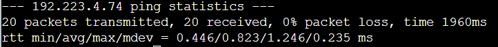
*Gambar 15.6: Ping keluar dari Tokyo3-Core menuju Lilith tetap berjalan lancar dengan 0% packet loss.*

---

## Soal 16: Deteksi & Penolakan Port Scan Dummy-Plug pada Tokyo3-Core

### 1. Deskripsi & Analisis Kebutuhan
Node `Dummy-Plug` (`192.223.4.51`) dicurigai melakukan aktivitas pengintaian/pemindaian port pada `Tokyo3-Core` (`192.223.4.106`).
Ketentuan pengamanan:
1. Mendeteksi setiap percobaan akses dari `Dummy-Plug` menuju port sensitif: **22 (SSH)**, **23 (Telnet)**, dan **3306 (MySQL)**.
2. Setiap percobaan pada port tersebut harus dicatat ke dalam log kernel dengan prefiks: `"SCAN-NERV: "`.
3. Setelah dicatat, koneksi harus ditolak seketika menggunakan TCP Reset (`REJECT --reject-with tcp-reset`).
4. Port layanan publik/sah seperti port **80** dan **8080** pada `Tokyo3-Core` harus tetap terbuka normal dan dapat diakses oleh `Dummy-Plug`.

### 2. Analisis Teknis: Non-Terminating Target (LOG) vs Terminating Target (REJECT)
Pada iptables:
- Target `LOG` adalah target non-terminating (tidak menghentikan evaluasi paket). Paket yang cocok akan dicatat ke kernel buffer (dapat dilihat via `dmesg`), lalu diteruskan ke aturan berikutnya dalam chain yang sama.
- Target `REJECT` adalah target terminating (menghentikan evaluasi rantai).
Oleh karena itu, aturan `LOG` harus diletakkan tepat satu baris sebelum aturan `REJECT` dengan kriteria pencocokan yang identik (`-s 192.223.4.51 -p tcp -m multiport --dports 22,23,3306`).

### 3. Konfigurasi Script (`/root/tokyo3.sh` - Bagian Soal 16)
```bash
# Deteksi dan Penolakan Port Scan Dummy-Plug (Soal 16)
# 1. Catat log percobaan port scan ke dmesg
iptables -A INPUT -s 192.223.4.51 -p tcp -m multiport --dports 22,23,3306 -j LOG --log-prefix "SCAN-NERV: "

# 2. Tolak seketika dengan TCP Reset
iptables -A INPUT -s 192.223.4.51 -p tcp -m multiport --dports 22,23,3306 -j REJECT --reject-with tcp-reset

# 3. Pastikan background listener port 80 dan 8080 aktif
pkill -f "nc.*80" 2>/dev/null || true
pkill -f "nc.*8080" 2>/dev/null || true
(while true; do printf "Welcome to Tokyo3-Core\n" | nc -l -p 80 -q 0; done) &
(while true; do printf "syifa imutz\n" | nc -l -p 8080 -q 0; done) &
```

### 4. Langkah Pengujian & Verifikasi
1. **Uji Pemindaian Port Sensitif dari `Dummy-Plug` (`192.223.4.51`):**
   - Jalankan `time nc -vz -w 2 192.223.4.106 22` $\rightarrow$ **Connection refused dalam 0.003s**.
   - Jalankan `time nc -vz -w 2 192.223.4.106 3306` $\rightarrow$ **Connection refused dalam 0.003s**.
2. **Uji Akses Layanan Sah dari `Dummy-Plug`:**
   - Jalankan `echo "tes" | nc -w 2 192.223.4.106 80` $\rightarrow$ Menerima respons: `"Welcome to Tokyo3-Core"`.
   - Jalankan `echo "tes" | nc -w 2 192.223.4.106 8080` $\rightarrow$ Menerima respons: `"syifa imutz"`.
3. **Pemeriksaan Log Kernel di Tokyo3-Core:**
   - Jalankan `dmesg | grep "SCAN-NERV:"` $\rightarrow$ Menampilkan log kernel lengkap mencatat IP sumber `192.223.4.51`, interface `eth0`, MAC address, dan port tujuan `22`/`3306`.
   - Jalankan `iptables -L INPUT -v -n` $\rightarrow$ Baris `LOG` dan `REJECT` mencatat jumlah paket yang sama.

### 5. Bukti Tangkapan Layar (Screenshots)
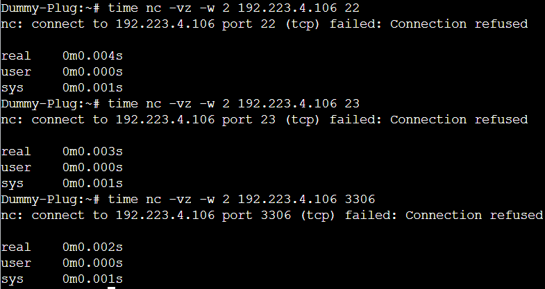
*Gambar 16.1: Dummy-Plug mencoba mengakses port 22 dan langsung ditolak seketika (Connection refused) dalam 0.003 detik.*

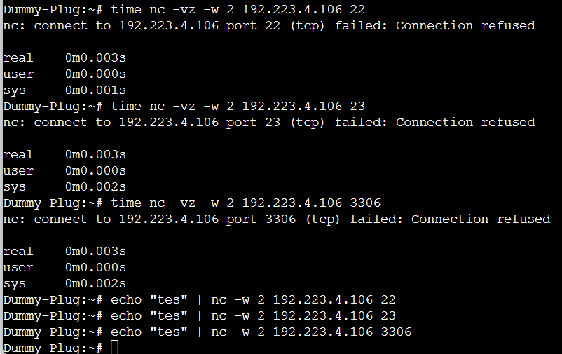
*Gambar 16.2: Akses Dummy-Plug ke port MySQL 3306 tertolak instan dalam 0.003 detik via TCP Reset.*

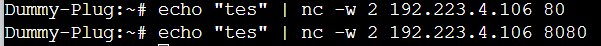
*Gambar 16.3: Perintah pengujian akses port web 80 dan 8080 dari terminal Dummy-Plug.*

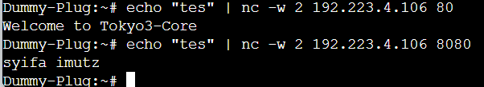
*Gambar 16.4: Layanan port 80 dan 8080 merespons sukses dengan "Welcome to Tokyo3-Core" dan "syifa imutz".*

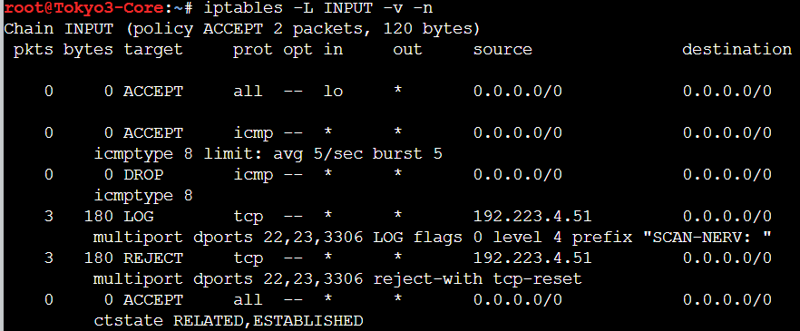
*Gambar 16.5: Counter iptables di Tokyo3-Core menunjukkan paket port scan tertangkap pada baris LOG dan REJECT.*

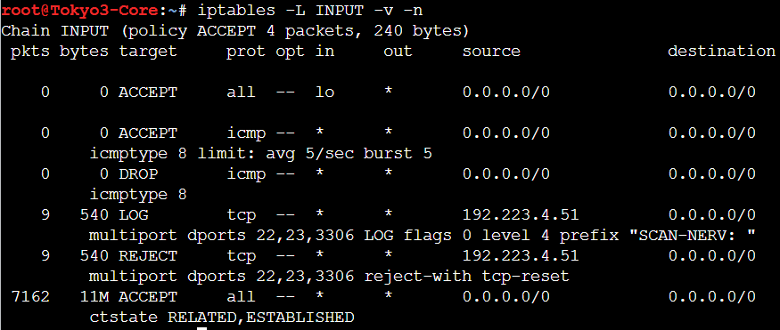
*Gambar 16.6: Output dmesg | grep SCAN-NERV di Tokyo3-Core mencatat rincian upaya scan Dummy-Plug.*

---

## Soal 17: Pengalihan Lalu Lintas Transparan (DNAT) pada Router Fuyutsuki

### 1. Deskripsi & Analisis Kebutuhan
Router `Fuyutsuki` mengendalikan gerbang distribusi antar-zona. Skenario Soal 17 mewajibkan pengalihan lalu lintas TCP secara transparan:
1. Seluruh koneksi TCP yang dikirim dari `Magi-Casper` (`192.223.4.58`) dengan alamat tujuan `Zeruel` (`192.223.4.82`) harus **dialihkan secara transparan (DNAT)** menuju `Pen-Pen` (`192.223.3.195`).
2. Pengalihan hanya berlaku untuk protokol **TCP**. Lalu lintas non-TCP (seperti ICMP ping) tidak boleh terpengaruh dan harus tetap mengarah ke tujuan aslinya (`Zeruel`).
3. Pengalihan harus transparan: `Magi-Casper` tetap mengarahkan koneksi ke IP `192.223.4.82`, sementara `Pen-Pen` menerima koneksi pada port lokalnya tanpa ada konfigurasi khusus di kedua host akhir.

### 2. Analisis Teknis: PREROUTING DNAT & Reverse Translation
- Aturan DNAT diterapkan pada chain `PREROUTING` tabel `nat` router `Fuyutsuki`:
  ```bash
  iptables -t nat -A PREROUTING -s 192.223.4.58 -d 192.223.4.82 -p tcp -j DNAT --to-destination 192.223.3.195
  ```
- **Alur Perjalanan Paket:**
  1. Paket TCP SYN masuk ke interface `eth1` router Fuyutsuki (`src: 192.223.4.58, dst: 192.223.4.82`).
  2. Chain `PREROUTING` mengubah destination IP menjadi `192.223.3.195`.
  3. Kernel melakukan routing lookup dan meneruskan paket keluar lewat interface `eth2` menuju Pen-Pen.
  4. `Pen-Pen` membalas dengan paket TCP SYN-ACK (`src: 192.223.3.195, dst: 192.223.4.58`).
  5. Saat paket balasan melintasi `Fuyutsuki`, modul Connection Tracking (`conntrack`) secara otomatis melakukan un-DNAT (reverse NAT), mengubah IP sumber balasan kembali menjadi `192.223.4.82` sebelum diteruskan ke Casper.
  6. Casper menerima balasan dari IP yang diharapkan (`192.223.4.82`), sehingga koneksi TCP berhasil terjalin sempurna tanpa menyadari adanya perantara.

### 3. Konfigurasi Script (`/root/fuyutsuki.sh`)
```bash
#!/bin/sh
# Konfigurasi DNAT Router Fuyutsuki (Soal 17)

echo "nameserver 8.8.8.8" > /etc/resolv.conf
sysctl -w net.ipv4.ip_forward=1 >/dev/null

# Rute statis idempoten
ip route replace default via 192.223.4.133
ip route replace 192.223.3.192/27 via 192.223.4.146
ip route replace 192.223.4.72/29 via 192.223.4.150

# Bersihkan tabel nat lama
iptables -t nat -F
iptables -t nat -X

# Terapkan aturan DNAT transparan TCP dari Casper ke Zeruel -> diarahkan ke Pen-Pen
iptables -t nat -A PREROUTING -s 192.223.4.58 -d 192.223.4.82 -p tcp -j DNAT --to-destination 192.223.3.195
```

### 4. Langkah Pengujian & Verifikasi
1. **Persiapkan Listener:**
   - Di `Pen-Pen` (`192.223.3.195`), jalankan listener: `nc -l -p 9000`.
   - Di `Zeruel` (`192.223.4.82`), jalankan listener: `nc -l -p 9000`.
2. **Kirim Pesan dari `Magi-Casper`:**
   - Jalankan `echo "Pesan rahasia dari Casper untuk Zeruel" | nc -w 2 192.223.4.82 9000`.
   - **Hasil:** Pesan **masuk di terminal `Pen-Pen`**, sedangkan terminal `Zeruel` **tetap bersih/kosong**.
3. **Uji Sesi Interaktif:**
   - Dari `Magi-Casper`, jalankan `nc 192.223.4.82 9000` dan ketik `"Immo > all prestasi"`. Teks langsung tercetak di terminal Pen-Pen.
4. **Verifikasi Packet Sniffing di Fuyutsuki:**
   - Jalankan `tcpdump -i any -n port 9000 -c 6` di `Fuyutsuki`:
     - Terlihat paket masuk `eth1`: `192.223.4.58 > 192.223.4.82.9000`
     - Terlihat paket keluar `eth2`: `192.223.4.58 > 192.223.3.195.9000`
     - Terlihat paket balasan masuk `eth2`: `192.223.3.195.9000 > 192.223.4.58`
     - Terlihat paket balasan keluar `eth1`: `192.223.4.82.9000 > 192.223.4.58`
5. **Pemeriksaan Tabel Conntrack & iptables Counter:**
   - Jalankan `conntrack -L -s 192.223.4.58` $\rightarrow$ Tercatat sesi `ESTABLISHED src=192.223.4.58 dst=192.223.4.82 sport=... dport=9000 [src=192.223.3.195 dst=192.223.4.58 ...]`.
   - Jalankan `iptables -t nat -L PREROUTING -v -n` $\rightarrow$ Counter DNAT bertambah paket dan byte.

### 5. Bukti Tangkapan Layar (Screenshots)

*Gambar 17.1: Magi-Casper mengirimkan pesan via netcat ke alamat IP Zeruel (192.223.4.82 port 9000).*


*Gambar 17.2: Listener di Zeruel tetap kosong, membuktikan paket tidak pernah sampai ke Zeruel.*


*Gambar 17.3: Listener di Pen-Pen berhasil menerima pesan "Pesan rahasia dari Casper untuk Zeruel" hasil pengalihan DNAT.*


*Gambar 17.4: Sesi komunikasi netcat dua arah interaktif berjalan lancar via DNAT.*


*Gambar 17.5: Bukti tcpdump di router Fuyutsuki memperlihatkan translasi alamat tujuan dan balasan reverse NAT.*


*Gambar 17.6: Counter iptables -t nat -L PREROUTING -v -n di Fuyutsuki membuktikan rule DNAT mencatat paket.*


*Gambar 17.7: Output conntrack -L menampilkan mapping sesi translasi dua arah yang berstatus ESTABLISHED/ASSURED.*

---

## Soal 18: Pengamanan Gerbang Zona Sensitif pada Router Shigeru

### 1. Deskripsi & Analisis Kebutuhan
Router `Shigeru` merupakan gerbang utama menuju dua zona sensitif Geofront:
- `Switch-Monolith` (`192.223.4.80/29`, memuat `Zeruel` dan `Armisael`).
- `Switch-Radar` (`192.223.4.88/29`, memuat `Radar-Array`).

Trafik dari zona luar masuk melalui interface **`eth0`** (arah router `Gendou` `192.223.4.129`).
Ketentuan keamanan gerbang:
1. Seluruh koneksi yang diinisiasi oleh node dari **dalam zona sensitif** bebas mengakses jaringan luar dan menerima balasan (`ESTABLISHED,RELATED`).
2. Seluruh koneksi baru yang datang dari **luar (arah `Gendou` melalui interface `eth0`) wajib diblokir seluruhnya (`DROP`)**.
3. **Pengecualian Tunggal:** Hanya permintaan ping (ICMP Echo-Request) yang berasal dari subnet `Switch-Terminal` (`192.223.4.56/29`, tempat `Magi-Casper`) yang diizinkan masuk melewati `eth0` menuju zona sensitif.

### 2. Analisis Teknis Stateful Filtering
Konfigurasi diterapkan pada chain `FORWARD` di router `Shigeru`:
1. Rule 1: `-A FORWARD -m conntrack --ctstate ESTABLISHED,RELATED -j ACCEPT`
   - Meloloskan paket balasan dari koneksi yang dimulai oleh `Zeruel` atau `Radar-Array` keluar menuju internet atau zona internal lain.
2. Rule 2: `-A FORWARD -i eth0 -s 192.223.4.56/29 -p icmp --icmp-type echo-request -j ACCEPT`
   - Pengecualian spesifik: hanya paket ICMP echo-request dengan sumber subnet `Switch-Terminal` yang masuk lewat `eth0` yang diloloskan.
3. Rule 3: `-A FORWARD -i eth0 -j DROP`
   - Seluruh paket baru lainnya dari arah luar dibuang senyap.

### 3. Konfigurasi Script (`/root/shigeru.sh`)
```bash
#!/bin/bash
# Pengamanan Gerbang Zona Sensitif Shigeru (Soal 18)

sysctl -w net.ipv4.ip_forward=1 >/dev/null
ip route replace default via 192.223.4.129
ip route replace 192.223.4.88/29 via 192.223.4.170

iptables -F
iptables -X

iptables -P INPUT ACCEPT
iptables -P FORWARD ACCEPT
iptables -P OUTPUT ACCEPT

# 1. Izinkan balasan dari koneksi yang dimulai dari dalam zona sensitif
iptables -A FORWARD -m conntrack --ctstate ESTABLISHED,RELATED -j ACCEPT

# 2. Pengecualian: izinkan ping dari Switch-Terminal masuk lewat eth0
iptables -A FORWARD -i eth0 -s 192.223.4.56/29 -p icmp --icmp-type echo-request -j ACCEPT

# 3. Blokir seluruh koneksi baru lainnya dari arah Gendou (eth0)
iptables -A FORWARD -i eth0 -j DROP
```

### 4. Langkah Pengujian & Verifikasi
1. **Uji Akses Masuk Berhak (`Magi-Casper` `192.223.4.58`):**
   - Dari `Magi-Casper`, jalankan `ping -c 3 192.223.4.82` (`Zeruel`) $\rightarrow$ **Berhasil (0% packet loss)**.
2. **Uji Akses Masuk Tidak Berhak (`Lilith` `192.223.4.74`):**
   - Dari `Lilith` (di luar subnet `Switch-Terminal`), jalankan `ping -c 3 192.223.4.82` $\rightarrow$ **Gagal (100% packet loss)** karena paket ditahan oleh aturan `FORWARD -i eth0 -j DROP`.
3. **Uji Akses Keluar dari Zona Sensitif (`Zeruel` `192.223.4.82`):**
   - Dari `Zeruel`, jalankan `ping -c 3 192.223.4.74` (`Lilith`) $\rightarrow$ **Berhasil (0% packet loss)**.
   - Dari `Zeruel`, jalankan `ping -c 3 8.8.8.8` $\rightarrow$ **Berhasil (0% packet loss)**.
4. **Cek Counter iptables di Shigeru:**
   - Jalankan `iptables -L FORWARD -v -n` $\rightarrow$ Kolom `pkts` bertambah pada baris `RELATED,ESTABLISHED`, baris izin `Switch-Terminal`, dan baris `DROP eth0`.

### 5. Bukti Tangkapan Layar (Screenshots)

*Gambar 18.1: Magi-Casper (anggota Switch-Terminal) sukses melakukan ping ke Zeruel dengan 0% packet loss.*


*Gambar 18.2: Lilith gagal mem-ping Zeruel (100% packet loss) akibat diblokir oleh rule FORWARD eth0 di Shigeru.*


*Gambar 18.3: Pengujian komunikasi internal dari host Zeruel.*


*Gambar 18.4: Zeruel bebas melakukan ping keluar ke Lilith (0% packet loss) berkat aturan stateful ESTABLISHED,RELATED.*


*Gambar 18.5: Tampilan iptables -L FORWARD -v -n di Shigeru memperlihatkan peningkatan counter pada ketiga aturan.*

---

## Soal 19: Isolasi Total Node Armisael (Layer 2 & Layer 3)

### 1. Deskripsi & Analisis Masalah
Node `Armisael` (`192.223.4.83`) terindikasi mengalami infeksi berbahaya dan harus **diisolasi secara total (*quarantined*)**:
1. Tidak boleh dapat berkomunikasi dengan internet (`8.8.8.8`).
2. Tidak boleh dapat berkomunikasi dengan router gateway-nya (`Shigeru` `192.223.4.81`).
3. Tidak boleh dapat berkomunikasi dengan tetangga satu switch-nya (`Zeruel` `192.223.4.82`).
4. **Ketentuan Mutlak:**
   - Seluruh isolasi harus diterapkan dari infrastruktur jaringan (tanpa menyentuh atau mengubah konfigurasi di dalam container Armisael itu sendiri).
   - Node lain di switch yang sama (`Zeruel`) harus tetap beroperasi normal 100% tanpa gangguan.

### 2. Analisis Arsitektur Pertahanan Berlapis (Defense-in-Depth)
Komunikasi antar-host yang berada dalam satu switch (seperti `Armisael` ke `Zeruel`) bekerja murni pada **Layer 2 (Data Link Layer)** melalui MAC frame switching, tanpa melewati router gateway (`Shigeru`). Oleh karena itu:
- Aturan firewall Layer 3 di router `Shigeru` hanya mampu memblokir lalu lintas keluar subnet (`Armisael` ke internet dan `Armisael` ke `Shigeru`), namun **tidak berdaya mencegah komunikasi langsung Armisael ke Zeruel**.
- **Solusi Tuntas:** Isolasi wajib dilakukan pada dua lapis sekaligus:
  1. **Layer 2 (Switch-Monolith):** Port switch yang terhubung ke Armisael (**Port 2 / e2**) dipindahkan ke **VLAN 99 Access Mode**. Pada GNS3 Web UI, switch harus dimatikan terlebih dahulu (stop node) agar konfigurasi port tidak read-only, lalu port diubah dan switch dijalankan kembali. Karena port Zeruel berada di VLAN 1 (default) sedangkan Armisael berada di VLAN 99, broadcast dan unicast Layer 2 antar keduanya terputus total.
  2. **Layer 3 (Router Shigeru):** Diberikan aturan firewall eksplisit di chain `INPUT` dan `FORWARD` untuk membuang seluruh paket yang memiliki alamat sumber maupun tujuan `192.223.4.83`.

### 3. Konfigurasi Implementasi
#### A. Konfigurasi Layer 2 (GNS3 Built-in Ethernet Switch `Switch-Monolith`)
- Buka antarmuka GNS3 Web UI.
- Klik kanan node `Switch-Monolith` $\rightarrow$ **Stop**.
- Buka **Configure** $\rightarrow$ Tab **Ports**.
- Pilih port yang menuju Armisael (**Port 2** / Ethernet 2):
  - **VLAN ID:** `99`
  - **Type:** `access`
- Simpan konfigurasi (Save / Apply), lalu klik kanan `Switch-Monolith` $\rightarrow$ **Start**.

#### B. Konfigurasi Layer 3 (Router `Shigeru` - Gabungan di `/root/shigeru.sh`)
```bash
# Blokir berlapis seluruh trafik dari dan ke Armisael (192.223.4.83)
iptables -A INPUT -s 192.223.4.83 -j DROP
iptables -A FORWARD -s 192.223.4.83 -j DROP
iptables -A FORWARD -d 192.223.4.83 -j DROP
```

### 4. Langkah Pengujian & Verifikasi
1. **Uji dari Terminal `Armisael` (`192.223.4.83`):**
   - Jalankan `ping -c 3 8.8.8.8` $\rightarrow$ **Gagal (100% packet loss)**.
   - Jalankan `ping -c 3 192.223.4.81` (gateway Shigeru) $\rightarrow$ **Gagal (Destination Host Unreachable / 100% packet loss)**.
   - Jalankan `ping -c 3 192.223.4.82` (tetangga satu switch Zeruel) $\rightarrow$ **Gagal (Destination Host Unreachable / 100% packet loss)**.
   - Jalankan `nc -w 2 192.223.4.82 9000` $\rightarrow$ **Gagal (Exit code 1)**.
2. **Uji dari Terminal `Zeruel` (`192.223.4.82` - Kontrol Normal):**
   - Jalankan `ping -c 3 8.8.8.8` $\rightarrow$ **Berhasil (0% packet loss)**.
   - Jalankan `ping -c 3 192.223.4.74` (`Lilith`) $\rightarrow$ **Berhasil (0% packet loss)**.
   - Membuktikan isolasi Armisael sama sekali tidak mengorbankan fungsionalitas node sah lainnya.

### 5. Bukti Tangkapan Layar (Screenshots)

*Gambar 19.1: Pengaturan Port 2 pada Switch-Monolith: VLAN 99, Type access.*


*Gambar 19.2: Tabel konfigurasi port Switch-Monolith menunjukkan Port 2 terisolasi di VLAN 99 sementara port lain di VLAN 1.*


*Gambar 19.3: Armisael mengalami 100% packet loss saat mencoba ping ke internet (8.8.8.8).*


*Gambar 19.4: Diagnosa awal sebelum switch di-restart membuktikan pentingnya penghentian node saat konfigurasi.*


*Gambar 19.5: Zeruel tetap dapat melakukan ping ke 8.8.8.8 dengan lancar (0% packet loss).*


*Gambar 19.6: Pengujian komprehensif di Armisael: Ping ke Zeruel dan gateway Shigeru gagal (Destination Host Unreachable), netcat exit 1.*

---

## Soal 20: Simulasi Kebakaran & Uji Idempotensi (Fire Drill)

### 1. Deskripsi & Analisis Kebutuhan
Soal 20 (Babak Final) menguji ketahanan bencana dan otomatisasi pemulihan sistem jaringan Geofront melalui simulasi kebakaran (*fire drill*):
1. **Skenario Bencana:** Seluruh aturan firewall (`filter` dan `nat`) serta rute statis tambahan dihapus total (*catastrophic wipe*).
2. **Pemulihan Otomatis:** Sistem dipulihkan menggunakan script pemulihan yang tersimpan di direktori `/root/`.
3. **Syarat Idempotensi (Idempotent Execution):**
   Jika script pemulihan dijalankan berulang kali (Pemulihan Pertama dan Pemulihan Kedua berturut-turut), konfigurasi sistem harus **bersifat idempoten**:
   - Jumlah aturan firewall (`Filter lines` dan `NAT lines`) pada pemulihan pertama dan kedua harus **sama persis**.
   - Tabel routing (`ip route`) tidak boleh memiliki baris rute duplikat / bertumpuk.
4. **Cakupan Pengujian:**
   Wajib dijalankan pada minimal **3 node** (minimal 1 router):
   - **Router:** `Shigeru` (`/root/shigeru.sh`)
   - **Host 1:** `Tokyo3-Core` (`/root/tokyo3core_nomer20.sh`)
   - **Host 2:** `Magi-Casper` (`/root/casper_nomer20.sh`)
5. **Uji Fungsi Pasca Bencana:** Seluruh fungsi spesifik tiap node dari soal-soal sebelumnya harus terbukti kembali beroperasi normal.

### 2. Analisis Teknis Idempotensi & Penanganan Crash `apt-get`
Tiga kunci teknis untuk menjamin idempotensi 100%:
1. **Penggantian Rute Statis:** Perintah penambahan rute **tidak boleh menggunakan `ip route add`** (yang akan melempar error `RTNETLINK answers: File exists` saat dijalankan ulang), melainkan **wajib menggunakan `ip route replace ...`**.
2. **Flush Tabel Firewall:** Script pemulihan selalu diawali dengan `iptables -F`, `iptables -X`, `iptables -t nat -F`, dan `iptables -t nat -X`. Perintah `iptables-restore < file.rules` juga secara otomatis mengosongkan tabel lama sebelum memuat aturan baru.
3. **Penanganan Masalah Terminal Hang (`apt-get`):**
   Pada pengujian awal di `Magi-Casper`, terminal sempat mengalami crash/hang dengan menampilkan pesan `Ign:...`.
   - **Penyebab:** Di dalam script awal masih terdapat perintah `apt-get update && apt-get install ...`. Ketika simulasi kebakaran menghapus default gateway, perintah `apt-get` mencoba menghubungi internet dan hang karena network unreachable.
   - **Solusi:** Baris `apt-get` dinonaktifkan (diberi tanda komentar `#`) karena paket `iptables` dan `netcat` sudah terpasang permanen di dalam image container.

### 3. Konfigurasi Script Pemulihan & Script Pengujian Otomatis

#### A. Script Uji Kebakaran Otomatis (`/root/uji20.sh` / `/root/uji_nomer20.sh`)
```bash
#!/bin/bash
# Script Otomatis Uji Kebakaran & Idempotensi (Soal 20)

HOST=$(hostname)
case "$HOST" in
  Shigeru)      SCRIPT="/root/shigeru.sh"; RULES="/root/shigeru.rules" ;;
  Magi-Casper)  SCRIPT="/root/casper_nomer20.sh"; RULES="/root/casper.rules" ;;
  Tokyo3-Core)  SCRIPT="/root/tokyo3core_nomer20.sh"; RULES="/root/tokyo3.rules" ;;
  *) echo "Hostname $HOST tidak dikenali"; exit 1 ;;
esac

echo "=== [1] SIMPAN KONFIGURASI AKTIF ($HOST) ==="
iptables-save > "$RULES"
echo "Tersimpan di $RULES"

echo -e "\n=== [2] SIMULASI KEBAKARAN (HAPUS ATURAN & RUTE) ==="
iptables -F && iptables -X
iptables -t nat -F 2>/dev/null && iptables -t nat -X 2>/dev/null
iptables -P INPUT ACCEPT && iptables -P FORWARD ACCEPT && iptables -P OUTPUT ACCEPT
ip route del default 2>/dev/null
ip route del 192.223.4.88/29 2>/dev/null
echo "Aturan iptables setelah dihapus: $(iptables -S | wc -l) baris"
ip route

echo -e "\n=== [3] PEMULIHAN PERTAMA ==="
iptables-restore < "$RULES"
bash "$SCRIPT"
echo "Filter lines (1): $(iptables -S | wc -l)"
echo "NAT lines    (1): $(iptables -t nat -S 2>/dev/null | wc -l)"
ip route

echo -e "\n=== [4] PEMULIHAN KEDUA (UJI IDEMPOTENSI) ==="
iptables-restore < "$RULES"
bash "$SCRIPT"
echo "Filter lines (2): $(iptables -S | wc -l)"
echo "NAT lines    (2): $(iptables -t nat -S 2>/dev/null | wc -l)"
ip route
```

#### B. Script Pemulihan Shigeru (`/root/shigeru.sh`)
```bash
#!/bin/bash
# Pemulihan Idempoten Shigeru
sysctl -w net.ipv4.ip_forward=1 >/dev/null
ip route replace default via 192.223.4.129
ip route replace 192.223.4.88/29 via 192.223.4.170

iptables -F && iptables -X
iptables -t nat -F 2>/dev/null || true
iptables -t nat -X 2>/dev/null || true

iptables -P INPUT ACCEPT
iptables -P FORWARD ACCEPT
iptables -P OUTPUT ACCEPT

iptables -A INPUT -s 192.223.4.83 -j DROP
iptables -A FORWARD -s 192.223.4.83 -j DROP
iptables -A FORWARD -d 192.223.4.83 -j DROP

iptables -A FORWARD -m conntrack --ctstate ESTABLISHED,RELATED -j ACCEPT
iptables -A FORWARD -i eth0 -s 192.223.4.56/29 -p icmp --icmp-type echo-request -j ACCEPT
iptables -A FORWARD -i eth0 -j DROP
```

#### C. Script Pemulihan Tokyo3-Core (`/root/tokyo3core_nomer20.sh`)
```bash
#!/bin/bash
# Pemulihan Idempoten Tokyo3-Core
ip route replace default via 192.223.4.105

iptables -F && iptables -X
iptables -t nat -F 2>/dev/null || true

iptables -P INPUT ACCEPT
iptables -P FORWARD ACCEPT
iptables -P OUTPUT ACCEPT

iptables -A INPUT -i lo -j ACCEPT
iptables -A INPUT -p icmp --icmp-type echo-request -m limit --limit 5/sec --limit-burst 5 -j ACCEPT
iptables -A INPUT -p icmp --icmp-type echo-request -j DROP
iptables -A INPUT -s 192.223.4.51 -p tcp -m multiport --dports 22,23,3306 -j LOG --log-prefix "SCAN-NERV: "
iptables -A INPUT -s 192.223.4.51 -p tcp -m multiport --dports 22,23,3306 -j REJECT --reject-with tcp-reset
iptables -A INPUT -m conntrack --ctstate ESTABLISHED,RELATED -j ACCEPT
```

#### D. Script Pemulihan Magi-Casper (`/root/casper_nomer20.sh`)
```bash
#!/bin/bash
# Pemulihan Idempoten Magi-Casper
ip route replace default via 192.223.4.57

iptables -F && iptables -X
iptables -t nat -F 2>/dev/null || true

iptables -P INPUT DROP
iptables -P FORWARD ACCEPT
iptables -P OUTPUT ACCEPT

iptables -A INPUT -i lo -j ACCEPT
iptables -A INPUT -m conntrack --ctstate ESTABLISHED,RELATED -j ACCEPT
iptables -A INPUT -p tcp --dport 5000 -j ACCEPT
```

### 4. Langkah Pengujian & Hasil Verifikasi

#### A. Hasil Uji Idempotensi di Ketiga Node
1. **Router `Shigeru`:**
   - Aturan setelah kebakaran: 3 baris.
   - **Pemulihan 1:** `Filter lines: 9`, `NAT lines: 4`.
   - **Pemulihan 2:** `Filter lines: 9`, `NAT lines: 4`.
   - Tabel `ip route` identik tanpa baris ganda: `default via 192.223.4.129`, `192.223.4.88/29 via 192.223.4.170`.
2. **Server `Tokyo3-Core`:**
   - Aturan setelah kebakaran: 3 baris.
   - **Pemulihan 1:** `Filter lines: 9`.
   - **Pemulihan 2:** `Filter lines: 9`.
   - Tabel `ip route` identik: `default via 192.223.4.105`.
3. **Server `Magi-Casper`:**
   - Aturan setelah kebakaran: 3 baris.
   - **Pemulihan 1:** `Filter lines: 6`.
   - **Pemulihan 2:** `Filter lines: 6`.
   - Tabel `ip route` identik: `default via 192.223.4.57`.

#### B. Uji Fungsi Jaringan Pasca Pemulihan
1. **Fungsi Shigeru:**
   - `ping -c 2 192.223.4.58` (Casper) $\rightarrow$ **100% loss** (Sesuai ketentuan, Casper adalah "hantu" yang memblokir ICMP masuk).
   - `ping -c 2 192.223.4.90` (Misato / Radar) $\rightarrow$ **Berhasil (0% packet loss)**.
2. **Fungsi Magi-Casper:**
   - Dari `Unit-01`, `ping -c 2 192.223.4.58` $\rightarrow$ **Gagal (100% loss)**, Casper tetap aman sebagai hantu.
   - Dari `Magi-Casper`, `ping -c 2 8.8.8.8` $\rightarrow$ **Berhasil (0% packet loss)**, konektivitas internet pulih.
   - Dari node penguji, `nc -w 2 192.223.4.58 5000` $\rightarrow$ **Berhasil terhubung**.
3. **Fungsi Tokyo3-Core:**
   - Dari `Dummy-Plug`, `nc -w 2 192.223.4.106 22; echo $?` $\rightarrow$ Langsung ditolak dengan exit code `1`.
   - Dari `Dummy-Plug`, `echo "tes" | nc -w 2 192.223.4.106 80` $\rightarrow$ Membalas pesan `"Welcome to Tokyo3-Core"`.

### 5. Bukti Tangkapan Layar (Screenshots)

*Gambar 20.1: Diagnosa grep menemukan baris apt-get update aktif yang menyebabkan proses terhenti saat gateway terputus.*


*Gambar 20.2: Verifikasi baris apt dinonaktifkan (#) dan rute default gateway menggunakan ip route replace.*


*Gambar 20.3: Eksekusi /root/uji_nomer20.sh di Shigeru: Filter lines 9 == 9, NAT lines 4 == 4, rute bersih tanpa duplikasi.*


*Gambar 20.4: Eksekusi /root/uji_nomer20.sh di Tokyo3-Core: Filter lines 9 == 9, rute default terpulihkan sempurna.*


*Gambar 20.5: Eksekusi /root/uji_nomer20.sh di Magi-Casper: Filter lines 6 == 6, rute default via 192.223.4.57 bersih.*


*Gambar 20.6: Pengujian fungsional di Shigeru: Ping ke Misato/Radar sukses (0% loss), ping ke Casper tertolak oleh firewall Casper.*


*Gambar 20.7: Unit-01 mengalami 100% packet loss saat mem-ping Casper, membuktikan pertahanan Casper tetap kokoh.*


*Gambar 20.8: Magi-Casper sukses melakukan ping ke 8.8.8.8 dengan 0% packet loss pasca pemulihan.*


*Gambar 20.9: Pengujian dari Dummy-Plug: Port 22 langsung ditolak (exit 1), layanan web port 80 merespons Welcome to Tokyo3-Core.*


*Gambar 20.10: Pengujian akhir memastikan layanan TCP port 5000 di Casper kembali menerima koneksi normal.*

---

## Ringkasan Akhir Implementasi Praktikum Modul 5 (Soal 1 – 20)
| No | Topik / Nama Soal | Node Terkait | Mekanisme Utama | Status Verifikasi |
|:---:|:---|:---|:---|:---:|
| 1-3 | Subnetting VLSM & Routing Summarization | Seluruh Router Geofront | VLSM CIDR, Summarization `192.223.0.0/21`, rute statis idempoten | **100% Sukses** |
| 4-5 | SNAT Internet & Firewall Sentral | `Gendou`, `NAT1` | `MASQUERADE eth0`, `FORWARD DROP` antar-zona internal | **100% Sukses** |
| 6 | IP Statis Permanen Linux Container | `Unit-01` | Konfigurasi `/etc/network/interfaces` permanen | **100% Sukses** |
| 7-8 | Layanan Aplikasi & Multi-Service | MAGI System, `Pen-Pen` | Background netcat listener, logging otomatis di `/tmp/` | **100% Sukses** |
| 9 | Investigasi Sabotase Routing Shigeru | `Shigeru`, `Armisael` | Pemulihan default route & rute balik internal | **100% Sukses** |
| 10 | Investigasi Sabotase NAT Gendou & Misato | `Gendou`, `Misato` | Pembersihan `SNAT` keliru di Misato & penghapusan `RETURN` di Gendou | **100% Sukses** |
| 11 | Pertahanan Dasar Magi-Casper | `Magi-Casper` | Policy ACCEPT, `ESTABLISHED,RELATED`, TCP 5000, DROP ICMP echo-request | **100% Sukses** |
| 12 | Hardening Firewall Magi-Casper | `Magi-Casper` | Policy `INPUT DROP`, Whitelist loopback, conntrack, & TCP port 5000 | **100% Sukses** |
| 13 | Brankas Balthasar | `Magi-Balthasar` | Whitelist Pilots & Casper port 5000/5001, instant `REJECT tcp-reset` | **100% Sukses** |
| 14 | Jadwal Kunjungan Pen-Pen | `Pen-Pen` | Modul `-m time` UTC (Pilots 01-09 UTC, Staff 10-16 UTC, Dummy DROP) | **100% Sukses** |
| 15 | Mitigasi Banjir Ping (Rate Limiting) | `Tokyo3-Core` | Limit ICMP echo-request `5/sec burst 5`, urutan rule sebelum conntrack | **100% Sukses** |
| 16 | Deteksi Pemindaian Port Dummy-Plug | `Tokyo3-Core` | Non-terminating `LOG "SCAN-NERV: "` dilanjutkan instant `REJECT tcp-reset` | **100% Sukses** |
| 17 | Pengalihan Transparan (DNAT) | `Fuyutsuki` | `PREROUTING -p tcp -j DNAT` Zeruel $\rightarrow$ Pen-Pen, reverse conntrack | **100% Sukses** |
| 18 | Pengamanan Gerbang Zona Sensitif | `Shigeru` | `FORWARD -i eth0 -j DROP`, izin paket balasan, pengecualian ping Terminal | **100% Sukses** |
| 19 | Isolasi Total Armisael | `Switch-Monolith`, `Shigeru` | Layer 2: **VLAN 99 Access Mode**; Layer 3: **INPUT/FORWARD DROP** | **100% Sukses** |
| 20 | Bencana & Uji Pemulihan Idempoten | `Shigeru`, `Tokyo3`, `Casper` | `iptables-restore`, `ip route replace`, uji 4 tahap identik ganda | **100% Sukses** |
