# Laporan Resmi Praktikum Komunikasi Data & Jaringan Komputer 2026 — Modul 5 (*Operation Geofront*)

## Member

| Nama                      | NRP        |
| ------------------------- | ---------- |
| Wildan Alfarezy       | 5027251088 |
| Ashkhabil Abror Budihardjo | 5027251049 |

---

## Arsitektur & Topologi GNS3

Topologi **Operation Geofront** terdiri dari **60 node** yang dibangun di GNS3 menggunakan image Docker resmi **`ardhptr21/debinet:latest`** dan **`ardhptr21/alpinet:latest`**:
- **1 `NAT1`** (terhubung eksklusif ke `Gendou` via DHCP)
- **17 Router:**
  - `debinet`: `Gendou`, `Fuyutsuki`, `Shigeru`, `Misato` (router yang menjalankan NAT, firewall, `conntrack`, dan script sabotase)
  - `alpinet`: `Yui`, `Rei`, `Shinji`, `Mari`, `Hikari`, `Kaworu`, `Asuka`, `Kensuke`, `Ritsuko`, `Kaji`, `Makoto`, `Maya`, `Toji`
- **17 `Ethernet switch`** (`Switch-Quarters` s/d `Switch-Cmd`)
- **25 Host / Server Container:**
  - `debinet`: `Tokyo3-Core`, `Magi-Casper`, `Magi-Balthasar`, `Magi-Melchior`, `Pen-Pen` (membutuhkan paket Debian `netcat-traditional`, `iptables`, `apt-get`)
  - `alpinet`: `Quarters`, `Comm-Net`, `Hangar-Crew`, `Sachiel`, `Medic-Bay`, `Relay-Node`, `Garden-Staff`, `Dock-Crew`, `Entry-Plug`, `Dummy-Plug`, `Unit-01`, `Unit-02`, `Unit-00`, `Lilith`, `Adam`, `Zeruel`, `Armisael`, `Radar-Array`, `Archive-Vault`, `Spy`


---

# Babak 1: Membangun Geofront

## Soal 1 — Markas Tanpa Peta (VLSM & Pohon Pembagian IP)

### Aturan Pembagian VLSM
- Prefix kelompok: **`192.223.0.0/16`**
- Kebutuhan alamat tiap LAN: `Jumlah Host + 1 (Gateway) + 2 (Network & Broadcast)`, menggunakan prefix terkecil yang muat.
- Kebutuhan tiap Link Antar-Router (16 link): `2 Router + 2 (Network & Broadcast) = 4 alamat (/30)`.
- Urutan alokasi: dari ukuran blok subnet terbesar ke terkecil. Sesuai ketentuan *tie-break*, jika ukuran blok sama maka **LAN didahulukan daripada Link**, lalu mengikuti **urutan Tabel Host**.
- Penomoran host pada switch mengikuti urutan penulisan node **kiri ke kanan** pada topologi (gateway selalu IP *usable* pertama).

### Tabel Pembagian VLSM (17 LAN + 16 Link Antar-Router)
File spreadsheet lengkap juga tersedia pada [tabel_vlsm_k24.csv](tabel_vlsm_k24.csv).

| No | Segmen / Subnet | Kebutuhan (Host+GW) | Network | Prefix | Gateway / Router | Broadcast | IP Terpakai | Sisa Usable | Alokasi IP Container di GNS3 |
| :-: | :--- | :-: | :--- | :-: | :--- | :--- | :--- | :-: | :--- |
| 1 | `Switch-Quarters` | 500 + 1 = **501** | `192.223.0.0` | `/23` | `192.223.0.1` (`Rei`) | `192.223.1.255` | 501 (`192.223.0.1` – `192.223.1.245`) | **9** | `Quarters` = `192.223.0.2` |
| 2 | `Switch-Comm` | 200 + 1 = **201** | `192.223.2.0` | `/24` | `192.223.2.1` (`Hikari`) | `192.223.2.255` | 201 (`192.223.2.1` – `192.223.2.201`) | **53** | `Comm-Net` = `192.223.2.2` |
| 3 | `Switch-Hangar` | 100 + 1 = **101** | `192.223.3.0` | `/25` | `192.223.3.1` (`Yui`) | `192.223.3.127` | 101 (`192.223.3.1` – `192.223.3.101`) | **25** | `Hangar-Crew` = `192.223.3.2` |
| 4 | `Switch-Bunker` | 55 + 1 = **56** | `192.223.3.128` | `/26` | `192.223.3.129` (`Kensuke`) | `192.223.3.191` | 56 (`192.223.3.129` – `192.223.3.184`) | **6** | `Sachiel` = `192.223.3.130` |
| 5 | `Switch-Medic` | 26 + 1 = **27** | `192.223.3.192` | `/27` | `192.223.3.193` (`Maya`) | `192.223.3.223` | 27 (`192.223.3.193` – `192.223.3.219`) | **3** | `Medic-Bay` = `.3.194`, `Pen-Pen` = `.3.195` |
| 6 | `Switch-Relay` | 25 + 1 = **26** | `192.223.3.224` | `/27` | `192.223.3.225` (`Kaworu`) | `192.223.3.255` | 26 (`192.223.3.225` – `192.223.3.250`) | **4** | `Relay-Node` = `192.223.3.226` |
| 7 | `Switch-Garden` | 14 + 1 = **15** | `192.223.4.0` | `/27` | `192.223.4.1` (`Shinji`) | `192.223.4.31` | 15 (`192.223.4.1` – `192.223.4.15`) | **15** | `Garden-Staff` = `192.223.4.2` |
| 8 | `Switch-Dock` | 12 + 1 = **13** | `192.223.4.32` | `/28` | `192.223.4.33` (`Mari`) | `192.223.4.47` | 13 (`192.223.4.33` – `192.223.4.45`) | **1** | `Dock-Crew` = `192.223.4.34` |
| 9 | **`Switch-Lab`** *(dilingkari)* | 5 + 1 = **6** | `192.223.4.48` | `/29` | `192.223.4.49` (`Ritsuko`) | `192.223.4.55` | 6 (`192.223.4.49` – `192.223.4.54`) | **0** | `Entry-Plug` = `.4.50`, `Dummy-Plug` = `.4.51` |
| 10 | `Switch-Terminal` | 3 + 1 = **4** | `192.223.4.56` | `/29` | `192.223.4.57` (`Fuyutsuki`) | `192.223.4.63` | 4 (`192.223.4.57` – `192.223.4.60`) | **2** | `Casper` = `.4.58`, `Balthasar` = `.4.59`, `Melchior` = `.4.60` |
| 11 | `Switch-Cage` | 3 + 1 = **4** | `192.223.4.64` | `/29` | `192.223.4.65` (`Misato`) | `192.223.4.71` | 4 (`192.223.4.65` – `192.223.4.68`) | **2** | `Unit-01` = `.4.66`, `Unit-02` = `.4.67`, `Unit-00` = `.4.68` |
| 12 | `Switch-Dogma` | 2 + 1 = **3** | `192.223.4.72` | `/29` | `192.223.4.73` (`Toji`) | `192.223.4.79` | 3 (`192.223.4.73` – `192.223.4.75`) | **3** | `Lilith` = `.4.74`, `Adam` = `.4.75` |
| 13 | **`Switch-Monolith`** *(dilingkari)* | 2 + 1 = **3** | `192.223.4.80` | `/29` | `192.223.4.81` (`Shigeru`) | `192.223.4.87` | 3 (`192.223.4.81` – `192.223.4.83`) | **3** | `Zeruel` = `.4.82`, `Armisael` = `.4.83` |
| 14 | `Switch-Radar` | 4 + 1 = **5** | `192.223.4.88` | `/29` | `192.223.4.89` (`Makoto`) | `192.223.4.95` | 5 (`192.223.4.89` – `192.223.4.93`) | **1** | `Radar-Array` = `192.223.4.90` |
| 15 | `Switch-Archive` | 1 + 1 = **2** | `192.223.4.96` | `/30` | `192.223.4.97` (`Asuka`) | `192.223.4.99` | 2 (`192.223.4.97` – `192.223.4.98`) | **0** | `Archive-Vault` = `192.223.4.98` |
| 16 | `Switch-Intel` | 1 + 1 = **2** | `192.223.4.100` | `/30` | `192.223.4.101` (`Kaji`) | `192.223.4.103` | 2 (`192.223.4.101` – `192.223.4.102`) | **0** | `Spy` = `192.223.4.102` |
| 17 | `Switch-Cmd` | 1 + 1 = **2** | `192.223.4.104` | `/30` | `192.223.4.105` (`Gendou`) | `192.223.4.107` | 2 (`192.223.4.105` – `192.223.4.106`) | **0** | `Tokyo3-Core` = `192.223.4.106` |
| 18 | `Link Gendou - Yui` | **2** | `192.223.4.108` | `/30` | `-` | `192.223.4.111` | 2 (`192.223.4.109` – `.110`) | **0** | `Gendou` = `.4.109`, `Yui` = `.4.110` |
| 19 | `Link Gendou - Hikari` | **2** | `192.223.4.112` | `/30` | `-` | `192.223.4.115` | 2 (`192.223.4.113` – `.114`) | **0** | `Gendou` = `.4.113`, `Hikari` = `.4.114` |
| 20 | **`Link Gendou - Asuka`** *(dilingkari)* | **2** | `192.223.4.116` | `/30` | `-` | `192.223.4.119` | 2 (`192.223.4.117` – `.118`) | **0** | `Gendou` = `.4.117`, `Asuka` = `.4.118` |
| 21 | `Link Gendou - Kaji` | **2** | `192.223.4.120` | `/30` | `-` | `192.223.4.123` | 2 (`192.223.4.121` – `.122`) | **0** | `Gendou` = `.4.121`, `Kaji` = `.4.122` |
| 22 | `Link Gendou - Misato` | **2** | `192.223.4.124` | `/30` | `-` | `192.223.4.127` | 2 (`192.223.4.125` – `.126`) | **0** | `Gendou` = `.4.125`, `Misato` = `.4.126` |
| 23 | **`Link Gendou - Shigeru`** *(dilingkari)* | **2** | `192.223.4.128` | `/30` | `-` | `192.223.4.131` | 2 (`192.223.4.129` – `.130`) | **0** | `Gendou` = `.4.129`, `Shigeru` = `.4.130` |
| 24 | `Link Gendou - Fuyutsuki` | **2** | `192.223.4.132` | `/30` | `-` | `192.223.4.135` | 2 (`192.223.4.133` – `.134`) | **0** | `Gendou` = `.4.133`, `Fuyutsuki` = `.4.134` |
| 25 | `Link Asuka - Kensuke` | **2** | `192.223.4.136` | `/30` | `-` | `192.223.4.139` | 2 (`192.223.4.137` – `.138`) | **0** | `Asuka` = `.4.137`, `Kensuke` = `.4.138` |
| 26 | **`Link Asuka - Ritsuko`** *(dilingkari)* | **2** | `192.223.4.140` | `/30` | `-` | `192.223.4.143` | 2 (`192.223.4.141` – `.142`) | **0** | `Asuka` = `.4.141`, `Ritsuko` = `.4.142` |
| 27 | `Link Fuyutsuki - Maya` | **2** | `192.223.4.144` | `/30` | `-` | `192.223.4.147` | 2 (`192.223.4.145` – `.146`) | **0** | `Fuyutsuki` = `.4.145`, `Maya` = `.4.146` |
| 28 | `Link Fuyutsuki - Toji` | **2** | `192.223.4.148` | `/30` | `-` | `192.223.4.151` | 2 (`192.223.4.149` – `.150`) | **0** | `Fuyutsuki` = `.4.149`, `Toji` = `.4.150` |
| 29 | `Link Yui - Rei` | **2** | `192.223.4.152` | `/30` | `-` | `192.223.4.155` | 2 (`192.223.4.153` – `.154`) | **0** | `Yui` = `.4.153`, `Rei` = `.4.154` |
| 30 | `Link Yui - Shinji` | **2** | `192.223.4.156` | `/30` | `-` | `192.223.4.159` | 2 (`192.223.4.157` – `.158`) | **0** | `Yui` = `.4.157`, `Shinji` = `.4.158` |
| 31 | `Link Yui - Mari` | **2** | `192.223.4.160` | `/30` | `-` | `192.223.4.163` | 2 (`192.223.4.161` – `.162`) | **0** | `Yui` = `.4.161`, `Mari` = `.4.162` |
| 32 | `Link Hikari - Kaworu` | **2** | `192.223.4.164` | `/30` | `-` | `192.223.4.167` | 2 (`192.223.4.165` – `.166`) | **0** | `Hikari` = `.4.165`, `Kaworu` = `.4.166` |
| 33 | `Link Shigeru - Makoto` | **2** | `192.223.4.168` | `/30` | `-` | `192.223.4.171` | 2 (`192.223.4.169` – `.170`) | **0** | `Shigeru` = `.4.169`, `Makoto` = `.4.170` |

### Gambar Pohon Pembagian IP (VLSM)
Lingkaran merah menandai **5 subnet** pada jalur paket dari **`Dummy-Plug`** menuju **`Armisael`**:
1. `192.223.4.48/29` (`Switch-Lab`: `Dummy-Plug` -> `Ritsuko`)
2. `192.223.4.140/30` (`Link Asuka - Ritsuko`)
3. `192.223.4.116/30` (`Link Gendou - Asuka`)
4. `192.223.4.128/30` (`Link Gendou - Shigeru`)
5. `192.223.4.80/29` (`Switch-Monolith`: `Shigeru` -> `Armisael`)

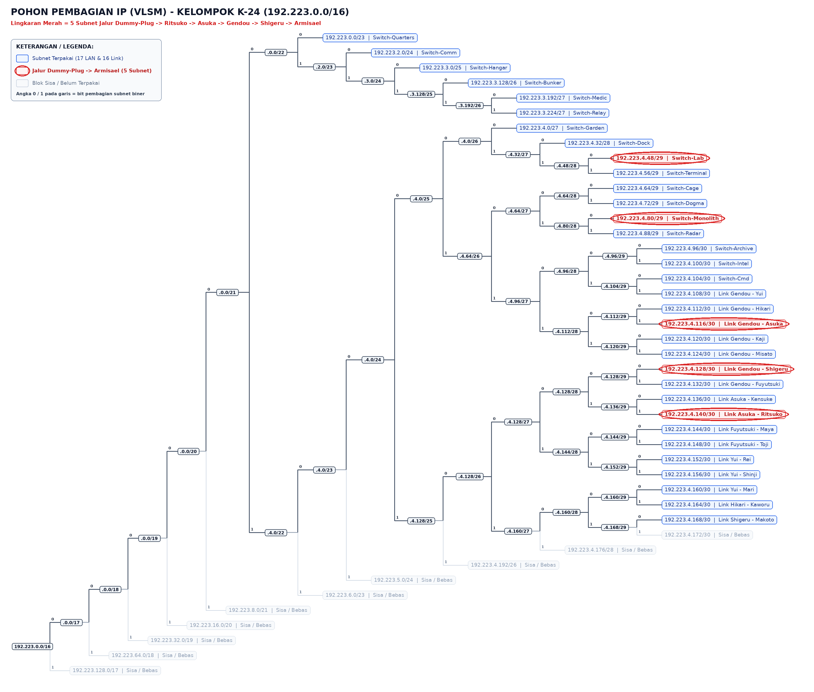

### Penjelasan Perhitungan Satu Subnet (`Switch-Medic`, Urutan ke-5)
- **Kebutuhan alamat:** Pada `Switch-Medic` terdapat `Pen-Pen` (1 host) dan `Medic-Bay` (25 host), ditambah 1 alamat gateway (`Maya`) serta 2 alamat khusus (*Network* dan *Broadcast*):
  $$\text{Total Alamat} = (1 + 25) + 1\text{ (Gateway)} + 2\text{ (Network \& Broadcast)} = 29\text{ alamat}$$
- **Penentuan prefix terkecil:** Dicari pangkat $2^n \ge 29$, diperoleh $2^5 = 32$ alamat ($n = 5$), sehingga prefix terkecil yang muat adalah $32 - 5 = \mathbf{/27}$ (`255.255.255.224`) dengan kapasitas IP *usable* sebesar $32 - 2 = 30$ IP.
- **Penentuan alamat & sisa:** Karena subnet sebelumnya (`Switch-Bunker`, `192.223.3.128/26`) berakhir di *broadcast* `192.223.3.191`, maka `Switch-Medic` dimulai tepat setelahnya:
  - **Network:** `192.223.3.192/27`
  - **Gateway (`Maya`):** `192.223.3.193`
  - **Alokasi Container (kiri -> kanan pada topologi):** `Medic-Bay` = `192.223.3.194`, `Pen-Pen` = `192.223.3.195`
  - **Broadcast:** `192.223.3.223` ($192 + 32 - 1 = 223$)
  - **IP Terpakai & Sisa:** Terpakai $27$ IP *usable* (26 host + 1 gateway), sehingga sisa IP *usable* = $30 - 27 = \mathbf{3\text{ IP}}$.

---

## Soal 2 — Geofront Gelap Gulita (Konfigurasi IP Router & IP Forwarding)

Setiap router diberi alamat IP pada `/etc/network/interfaces` sesuai pemetaan kabel `eth` pada kanvas GNS3 dan langsung mengaktifkan IP forwarding (`sysctl -w net.ipv4.ip_forward=1`). Hanya **`Gendou`** yang terhubung ke `NAT1` melalui `eth0` menggunakan **DHCP**.

### Konfigurasi `/etc/network/interfaces` Router Utama (Sesuai Kabel Aktual Kanvas GNS3)

<details>
<summary><b>Klik untuk melihat konfigurasi /etc/network/interfaces lengkap seluruh 17 Router</b></summary>

**1. `Gendou`** (`eth0`->NAT1, `eth1`->Switch-Cmd, `eth2`->Yui, `eth3`->Hikari, `eth4`->Fuyutsuki, `eth5`->Shigeru, `eth6`->Misato, `eth7`->Asuka, `eth8`->Kaji):
```ini
auto eth0
iface eth0 inet dhcp
    up sysctl -w net.ipv4.ip_forward=1

auto eth1
iface eth1 inet static
    address 192.223.4.105
    netmask 255.255.255.252

auto eth2
iface eth2 inet static
    address 192.223.4.109
    netmask 255.255.255.252

auto eth3
iface eth3 inet static
    address 192.223.4.113
    netmask 255.255.255.252

auto eth4
iface eth4 inet static
    address 192.223.4.133
    netmask 255.255.255.252

auto eth5
iface eth5 inet static
    address 192.223.4.129
    netmask 255.255.255.252

auto eth6
iface eth6 inet static
    address 192.223.4.125
    netmask 255.255.255.252

auto eth7
iface eth7 inet static
    address 192.223.4.117
    netmask 255.255.255.252

auto eth8
iface eth8 inet static
    address 192.223.4.121
    netmask 255.255.255.252
```

**2. `Yui`** (`eth0`->Gendou, `eth1`->Rei, `eth2`->Shinji, `eth3`->Mari, `eth4`->Switch-Hangar):
```ini
auto eth0
iface eth0 inet static
    address 192.223.4.110
    netmask 255.255.255.252
    up sysctl -w net.ipv4.ip_forward=1

auto eth1
iface eth1 inet static
    address 192.223.4.153
    netmask 255.255.255.252

auto eth2
iface eth2 inet static
    address 192.223.4.157
    netmask 255.255.255.252

auto eth3
iface eth3 inet static
    address 192.223.4.161
    netmask 255.255.255.252

auto eth4
iface eth4 inet static
    address 192.223.3.1
    netmask 255.255.255.128
```

**3. `Asuka`** (`eth0`->Gendou, `eth1`->Switch-Archive, `eth2`->Ritsuko, `eth3`->Kensuke):
```ini
auto eth0
iface eth0 inet static
    address 192.223.4.118
    netmask 255.255.255.252
    up sysctl -w net.ipv4.ip_forward=1

auto eth1
iface eth1 inet static
    address 192.223.4.97
    netmask 255.255.255.252

auto eth2
iface eth2 inet static
    address 192.223.4.141
    netmask 255.255.255.252

auto eth3
iface eth3 inet static
    address 192.223.4.137
    netmask 255.255.255.252
```

**4. `Fuyutsuki`** (`eth0`->Gendou, `eth1`->Switch-Terminal, `eth2`->Maya, `eth3`->Toji):
```ini
auto eth0
iface eth0 inet static
    address 192.223.4.134
    netmask 255.255.255.252
    up sysctl -w net.ipv4.ip_forward=1

auto eth1
iface eth1 inet static
    address 192.223.4.57
    netmask 255.255.255.248

auto eth2
iface eth2 inet static
    address 192.223.4.145
    netmask 255.255.255.252

auto eth3
iface eth3 inet static
    address 192.223.4.149
    netmask 255.255.255.252
```

**5. `Shigeru`** (`eth0`->Gendou, `eth1`->Switch-Monolith, `eth2`->Makoto):
```ini
auto eth0
iface eth0 inet static
    address 192.223.4.130
    netmask 255.255.255.252
    up sysctl -w net.ipv4.ip_forward=1

auto eth1
iface eth1 inet static
    address 192.223.4.81
    netmask 255.255.255.248

auto eth2
iface eth2 inet static
    address 192.223.4.169
    netmask 255.255.255.252
```

**6. `Hikari`** (`eth0`->Gendou, `eth1`->Switch-Comm, `eth2`->Kaworu):
```ini
auto eth0
iface eth0 inet static
    address 192.223.4.114
    netmask 255.255.255.252
    up sysctl -w net.ipv4.ip_forward=1

auto eth1
iface eth1 inet static
    address 192.223.2.1
    netmask 255.255.255.0

auto eth2
iface eth2 inet static
    address 192.223.4.165
    netmask 255.255.255.252
```

**7. 11 Router Ujung** (`eth0` ke router induk `/30`, `eth1` ke switch masing-masing):
- `Rei`: `eth0=192.223.4.154/30`, `eth1=192.223.0.1/23`
- `Shinji`: `eth0=192.223.4.158/30`, `eth1=192.223.4.1/27`
- `Mari`: `eth0=192.223.4.162/30`, `eth1=192.223.4.33/28`
- `Kaworu`: `eth0=192.223.4.166/30`, `eth1=192.223.3.225/27`
- `Kensuke`: `eth0=192.223.4.138/30`, `eth1=192.223.3.129/26`
- `Ritsuko`: `eth0=192.223.4.142/30`, `eth1=192.223.4.49/29`
- `Kaji`: `eth0=192.223.4.122/30`, `eth1=192.223.4.101/30`
- `Misato`: `eth0=192.223.4.126/30`, `eth1=192.223.4.65/29`
- `Makoto`: `eth0=192.223.4.170/30`, `eth1=192.223.4.89/29`
- `Maya`: `eth0=192.223.4.146/30`, `eth1=192.223.3.193/27`
- `Toji`: `eth0=192.223.4.150/30`, `eth1=192.223.4.73/29`

</details>

### Perintah Verifikasi Soal 2
```bash
# Cek interface & status ip_forward di tiap router
ip -br a
cat /proc/sys/net/ipv4/ip_forward

# Uji ping 7 link dari Gendou
for ip in 192.223.4.110 192.223.4.114 192.223.4.118 192.223.4.122 192.223.4.126 192.223.4.130 192.223.4.134; do
  ping -c 1 $ip | grep -E "PING|bytes from"
done
```

#### Bukti `ip -br a` dan Ping ke Seluruh 7 Router Anak dari `Gendou`


---

## Soal 3 — Pulau-Pulau yang Terpisah (Static Routing & Route Summarization)

Semua router selain `Gendou` cukup memiliki **1 default route ke atas** ditambah rute statis hanya untuk subnet di bawahnya. Seluruh script menggunakan `ip route replace` dan diletakkan di `/root/<nama>.sh` agar idempotent (tidak dobel saat dijalankan ulang).

### Ringkasan CIDR (*Route Summarization*) pada `Gendou`
- `192.223.4.80/29` (`Switch-Monolith`) + `192.223.4.88/29` (`Switch-Radar`) -> diringkas menjadi **`192.223.4.80/28`** via `Shigeru` (`192.223.4.130`).
- `192.223.4.136/30` (`Asuka-Kensuke`) + `192.223.4.140/30` (`Asuka-Ritsuko`) -> diringkas menjadi **`192.223.4.136/29`** via `Asuka` (`192.223.4.118`).
- `192.223.4.144/30` (`Fuyutsuki-Maya`) + `192.223.4.148/30` (`Fuyutsuki-Toji`) -> diringkas menjadi **`192.223.4.144/29`** via `Fuyutsuki` (`192.223.4.134`).
- `192.223.4.152/30` (`Yui-Rei`) + `192.223.4.156/30` (`Yui-Shinji`) -> diringkas menjadi **`192.223.4.152/29`** via `Yui` (`192.223.4.110`).

### Script Routing Router (`/root/<nama>.sh`)
- **`/root/yui.sh`:**
  ```sh
  #!/bin/sh
  sysctl -w net.ipv4.ip_forward=1
  ip route replace default via 192.223.4.109
  ip route replace 192.223.0.0/23 via 192.223.4.154
  ip route replace 192.223.4.0/27 via 192.223.4.158
  ip route replace 192.223.4.32/28 via 192.223.4.162
  ```
- **`/root/hikari.sh`:**
  ```sh
  #!/bin/sh
  sysctl -w net.ipv4.ip_forward=1
  ip route replace default via 192.223.4.113
  ip route replace 192.223.3.224/27 via 192.223.4.166
  ```
- **`/root/asuka.sh`:**
  ```sh
  #!/bin/sh
  sysctl -w net.ipv4.ip_forward=1
  ip route replace default via 192.223.4.117
  ip route replace 192.223.3.128/26 via 192.223.4.138
  ip route replace 192.223.4.48/29 via 192.223.4.142
  ```
- **`/root/shigeru.sh`:**
  ```sh
  #!/bin/sh
  echo "nameserver 8.8.8.8" > /etc/resolv.conf
  sysctl -w net.ipv4.ip_forward=1
  ip route replace default via 192.223.4.129
  ip route replace 192.223.4.88/29 via 192.223.4.170
  ```
- **`/root/fuyutsuki.sh`:**
  ```sh
  #!/bin/sh
  sysctl -w net.ipv4.ip_forward=1
  ip route replace default via 192.223.4.133
  ip route replace 192.223.3.192/27 via 192.223.4.146
  ip route replace 192.223.4.72/29 via 192.223.4.150
  ```
- **11 Router Ujung** (`rei.sh`, `shinji.sh`, `mari.sh`, `kaworu.sh`, `kensuke.sh`, `ritsuko.sh`, `kaji.sh`, `misato.sh`, `makoto.sh`, `maya.sh`, `toji.sh`): masing-masing berisi `sysctl -w net.ipv4.ip_forward=1` dan 1 baris `ip route replace default via <IP_Router_Induk>`.
- **`/root/gendo.sh`**: berisi 21 rute statis teringkas menuju seluruh cabang (digabung bersama NAT & Firewall pada bagian Soal 5 di bawah).

### Uji Konektivitas & Bukti Soal 3
```bash
# Cek tabel routing & summarization di Gendou
ip route

# Uji ping dari Armisael (192.223.4.83/29) ke Lilith, Sachiel, dan Comm-Net
ping -c 2 192.223.4.74    # Lilith
ping -c 2 192.223.3.130   # Sachiel
ping -c 2 192.223.2.2     # Comm-Net
```

#### Bukti Tabel Routing & Summarization (`/28` dan `/29`) di `Gendou`


#### Bukti `Armisael` Berhasil Ping ke `Lilith`, `Sachiel`, dan `Comm-Net`
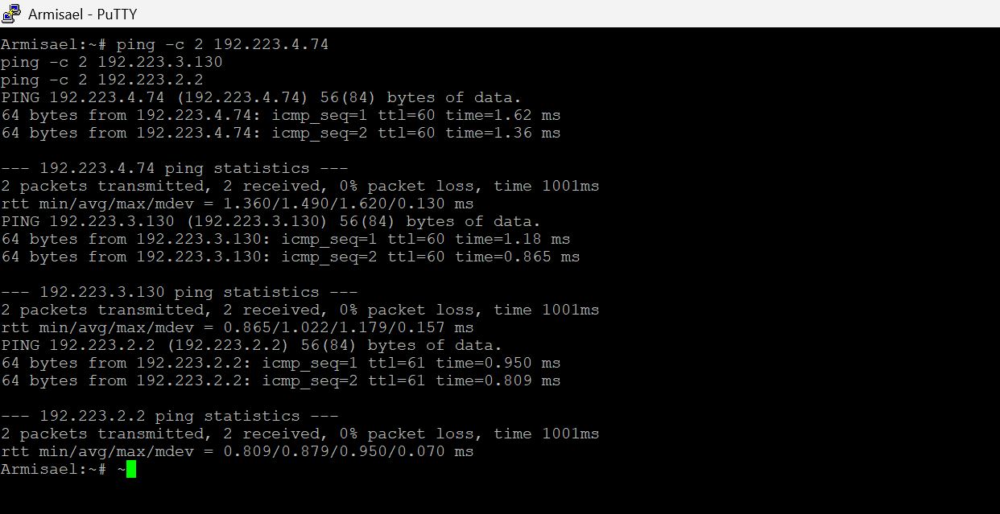

---

## Soal 4 — Haus Kabar dari Dunia Luar (NAT `MASQUERADE` & DNS)

Untuk memberikan akses internet ke seluruh subnet internal lewat `Gendou` tanpa perlu mengubah konfigurasi saat IP DHCP dari `NAT1` berubah, digunakan target **`MASQUERADE`** khusus untuk sumber prefix internal `192.223.0.0/16` yang keluar lewat interface `NAT1` (`eth0`). Traffic antar-LAN tidak melewati `eth0` sehingga tetap mempertahankan IP sumber aslinya.

### Perintah & Konfigurasi di `Gendou`
```bash
apt-get update && apt-get install -y iptables
NAT_IF=$(ip route show default | awk '{print $5; exit}')
iptables -t nat -F POSTROUTING
iptables -t nat -A POSTROUTING -s 192.223.0.0/16 -o "$NAT_IF" -j MASQUERADE
```

### Pengujian di `Armisael` & `Lilith`
```bash
echo "nameserver 8.8.8.8" > /etc/resolv.conf
ping -c 3 8.8.8.8
ping -c 3 deb.debian.org
```

#### Bukti Pengujian `Armisael` (`ping 8.8.8.8` & `ping deb.debian.org`)


#### Bukti Pengujian `Lilith` (`ping 8.8.8.8` & `ping deb.debian.org`)
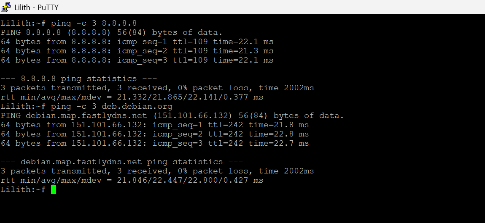

#### Bukti Counter Rule NAT `MASQUERADE` di `Gendou` (`pkts` & `bytes` Naik)
```bash
iptables -t nat -L POSTROUTING -v -n
```


---

## Soal 5 — Pintu Depan Dikunci Rapat (Firewall `Gendou` Policy `DROP`)

Policy `INPUT` dan `FORWARD` pada `Gendou` diubah menjadi **`DROP`** sehingga koneksi baru dari sisi `NAT1` (`eth0`) otomatis ditolak, sementara loopback, DHCP `NAT1` (UDP sport `67` -> dport `68`), balasan `ESTABLISHED,RELATED`, akses internal ke `Gendou`, internal ke internet, dan lalu lintas antar-LAN tetap diizinkan. Seluruh konfigurasi Soal 2–5 disatukan dalam **`/root/gendo.sh`**.

### Script Lengkap `/root/gendo.sh`
```sh
#!/bin/sh
# === SOAL 2: IP Forwarding ===
sysctl -w net.ipv4.ip_forward=1

# === SOAL 3: Static Routing + Summarization ===
# Cabang Yui (via 192.223.4.110)
ip route replace 192.223.0.0/23 via 192.223.4.110
ip route replace 192.223.3.0/25 via 192.223.4.110
ip route replace 192.223.4.0/27 via 192.223.4.110
ip route replace 192.223.4.32/28 via 192.223.4.110
ip route replace 192.223.4.152/29 via 192.223.4.110
ip route replace 192.223.4.160/30 via 192.223.4.110

# Cabang Hikari (via 192.223.4.114)
ip route replace 192.223.2.0/24 via 192.223.4.114
ip route replace 192.223.3.224/27 via 192.223.4.114
ip route replace 192.223.4.164/30 via 192.223.4.114

# Cabang Asuka (via 192.223.4.118)
ip route replace 192.223.3.128/26 via 192.223.4.118
ip route replace 192.223.4.48/29 via 192.223.4.118
ip route replace 192.223.4.96/30 via 192.223.4.118
ip route replace 192.223.4.136/29 via 192.223.4.118

# Cabang Kaji (via 192.223.4.122)
ip route replace 192.223.4.100/30 via 192.223.4.122

# Cabang Misato (via 192.223.4.126)
ip route replace 192.223.4.64/29 via 192.223.4.126

# Cabang Shigeru (via 192.223.4.130) - Switch-Monolith & Switch-Radar diringkas jadi /28
ip route replace 192.223.4.80/28 via 192.223.4.130
ip route replace 192.223.4.168/30 via 192.223.4.130

# Cabang Fuyutsuki (via 192.223.4.134)
ip route replace 192.223.3.192/27 via 192.223.4.134
ip route replace 192.223.4.56/29 via 192.223.4.134
ip route replace 192.223.4.72/29 via 192.223.4.134
ip route replace 192.223.4.144/29 via 192.223.4.134

# Deteksi interface NAT1 (default eth0)
NAT_IF=$(ip route show default | awk '{print $5; exit}')
[ -z "$NAT_IF" ] && NAT_IF="eth0"

# === SOAL 4: NAT MASQUERADE ===
iptables -t nat -F POSTROUTING
iptables -t nat -A POSTROUTING -s 192.223.0.0/16 -o "$NAT_IF" -j MASQUERADE

# === SOAL 5: Firewall Gendou (Policy INPUT & FORWARD = DROP) ===
iptables -F
iptables -X
iptables -P INPUT DROP
iptables -P FORWARD DROP
iptables -P OUTPUT ACCEPT

# INPUT: Loopback, ESTABLISHED/RELATED, DHCP dari NAT1, dan internal -> Gendou
iptables -A INPUT -i lo -j ACCEPT
iptables -A INPUT -m conntrack --ctstate ESTABLISHED,RELATED -j ACCEPT
iptables -A INPUT -i "$NAT_IF" -p udp --sport 67 --dport 68 -j ACCEPT
iptables -A INPUT ! -i "$NAT_IF" -s 192.223.0.0/16 -j ACCEPT

# FORWARD: (a) ESTABLISHED/RELATED, (b) Internal -> Internet, (c) Antar-LAN
iptables -A FORWARD -m conntrack --ctstate ESTABLISHED,RELATED -j ACCEPT
iptables -A FORWARD ! -i "$NAT_IF" -o "$NAT_IF" -s 192.223.0.0/16 -j ACCEPT
iptables -A FORWARD ! -i "$NAT_IF" ! -o "$NAT_IF" -s 192.223.0.0/16 -d 192.223.0.0/16 -j ACCEPT
```

#### Bukti `iptables -S` di `Gendou`
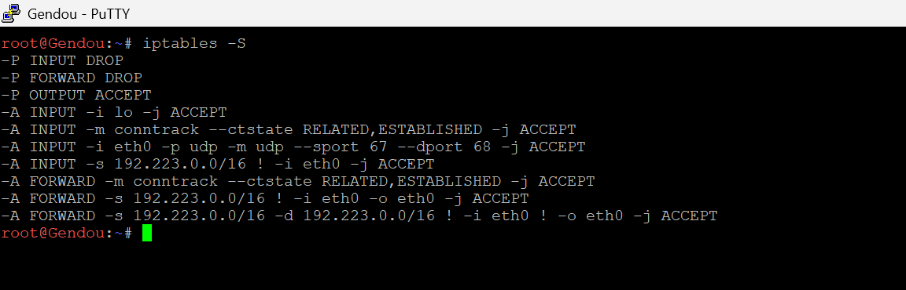

#### Bukti `Armisael` Tetap Dapat Ping `8.8.8.8` & `Lilith` (`192.223.4.74`)
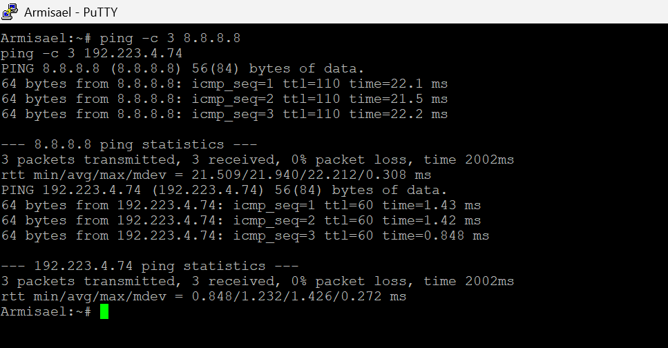

---

## Soal 6 — Alamat Para Pilot (IP Statis Permanen Semua 25 Host)

Seluruh 25 node non-router dikonfigurasi secara permanen melalui `/etc/network/interfaces` (beserta `up echo nameserver 8.8.8.8 > /etc/resolv.conf`) agar alamat IP, gateway, dan DNS tetap bertahan setelah container di-restart.

### Format Konfigurasi Permanen (Contoh pada `Unit-01`)
```ini
auto eth0
iface eth0 inet static
    address 192.223.4.66
    netmask 255.255.255.248
    gateway 192.223.4.65
    up echo nameserver 8.8.8.8 > /etc/resolv.conf
```

#### Uji Restart `Unit-01` di GNS3
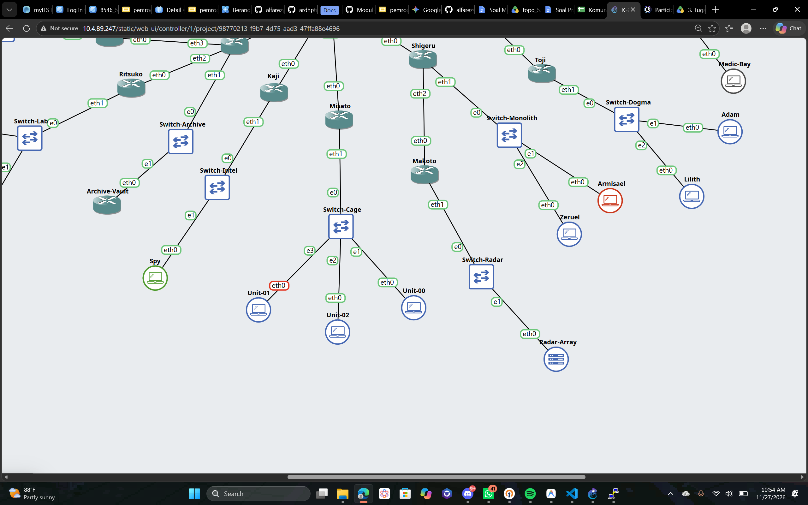

#### Bukti `ip -br a` dan `ping` ke Gateway (`192.223.4.65`) di `Unit-01` Setelah Restart


---

## Soal 7 — Membangunkan MAGI (`Casper`, `Balthasar`, `Melchior`)

Paket `iptables` dan `netcat-traditional` dipasang melalui script `/root/<nama>.sh` di masing-masing node MAGI, kemudian listener TCP dijalankan pada port sesuai glosarium (`Magi-Casper`: `5000`, `Magi-Balthasar`: `5000` & `5001`, `Magi-Melchior`: `5000`).

### Script pada Ketiga Node MAGI
- **`Magi-Casper` (`/root/casper.sh`):**
  ```sh
  #!/bin/sh
  apt-get update && apt-get install -y iptables netcat-traditional
  pkill -f "nc.traditional -l -p 5000" 2>/dev/null || true
  (while true; do nc.traditional -l -p 5000 >> /tmp/casper_5000.log; done) &
  ```
- **`Magi-Balthasar` (`/root/balthasar.sh`):**
  ```sh
  #!/bin/sh
  apt-get update && apt-get install -y iptables netcat-traditional
  pkill -f "nc.traditional -l -p 5000" 2>/dev/null || true
  pkill -f "nc.traditional -l -p 5001" 2>/dev/null || true
  (while true; do nc.traditional -l -p 5000 >> /tmp/balthasar_5000.log; done) &
  (while true; do nc.traditional -l -p 5001 >> /tmp/balthasar_5001.log; done) &
  ```
- **`Magi-Melchior` (`/root/melchior.sh`):**
  ```sh
  #!/bin/sh
  apt-get update && apt-get install -y iptables netcat-traditional
  pkill -f "nc.traditional -l -p 5000" 2>/dev/null || true
  (while true; do nc.traditional -l -p 5000 >> /tmp/melchior_5000.log; done) &
  ```

### Pengujian dari `Lilith`
```bash
echo "Halo Casper dari Lilith" | nc -w 2 192.223.4.58 5000
echo "Halo Balthasar 5000 dari Lilith" | nc -w 2 192.223.4.59 5000
echo "Halo Balthasar 5001 dari Lilith" | nc -w 2 192.223.4.59 5001
echo "Halo Melchior dari Lilith" | nc -w 2 192.223.4.60 5000
```

#### Bukti Pengiriman dari `Lilith`
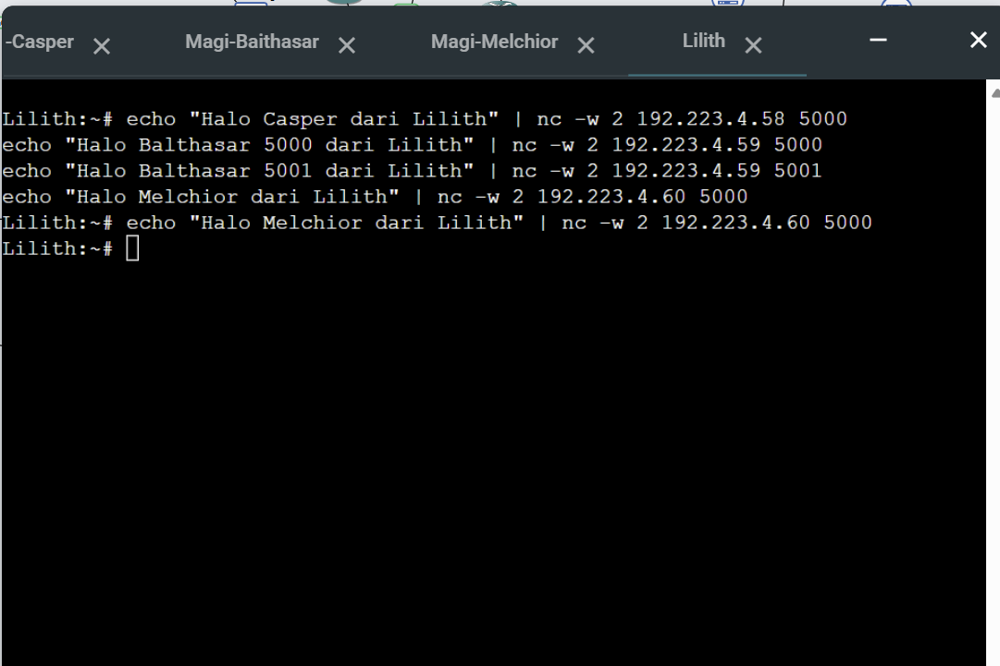

#### Bukti Pesan Diterima di `Magi-Casper` (Port 5000)
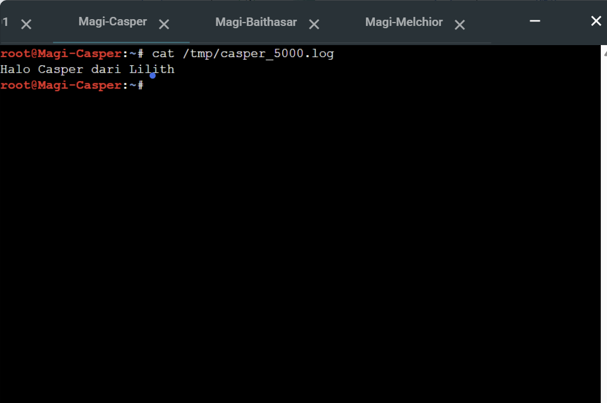

#### Bukti Pesan Diterima di `Magi-Balthasar` (Port 5000 & 5001)
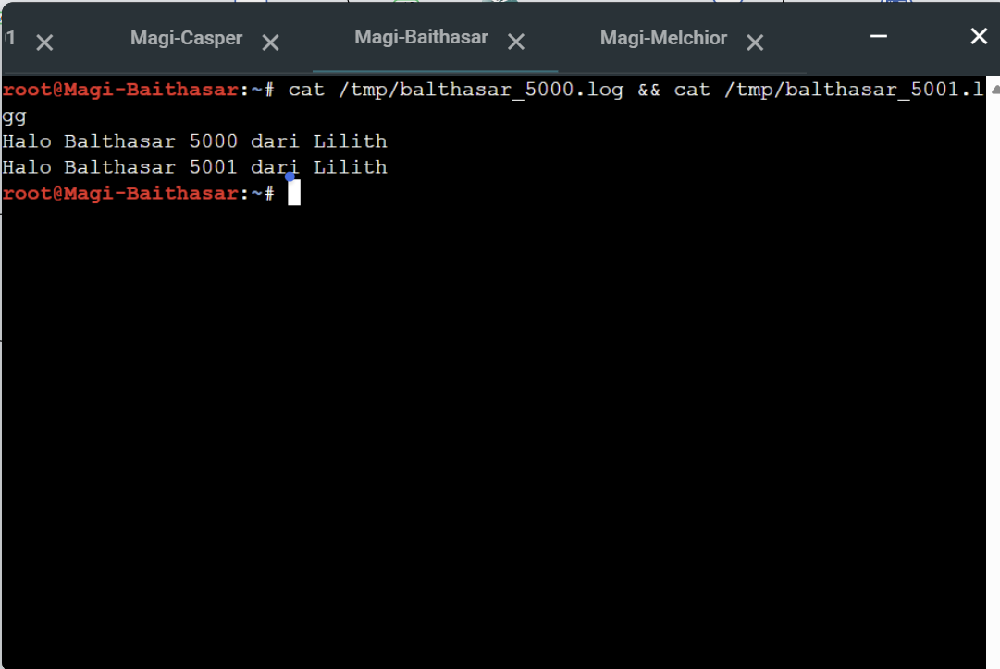

#### Bukti Pesan Diterima di `Magi-Melchior` (Port 5000)


---

## Soal 8 — Mengenali Kondisi Normal (`Pen-Pen` & `Tokyo3-Core`)

Listener `nc.traditional` dijalankan agar `Pen-Pen` (port `80`) menjawab `Welcome to Pen-Pen`, `Tokyo3-Core` (port `80`) menjawab `Welcome to Tokyo3-Core`, dan `Tokyo3-Core` (port `8080`) menjawab `syifa imutz`.

### Script Listener
- **`Pen-Pen` (`/root/penpen.sh`):**
  ```sh
  #!/bin/sh
  apt-get update && apt-get install -y iptables netcat-traditional
  pkill -f "nc.traditional -l -p 80" 2>/dev/null || true
  (while true; do printf "Welcome to Pen-Pen\n" | nc.traditional -l -p 80 -q 0; done) &
  ```
- **`Tokyo3-Core` (`/root/tokyo3core.sh`):**
  ```sh
  #!/bin/sh
  apt-get update && apt-get install -y iptables netcat-traditional
  pkill -f "nc.traditional -l -p 80" 2>/dev/null || true
  pkill -f "nc.traditional -l -p 8080" 2>/dev/null || true
  (while true; do printf "Welcome to Tokyo3-Core\n" | nc.traditional -l -p 80 -q 0; done) &
  (while true; do printf "syifa imutz\n" | nc.traditional -l -p 8080 -q 0; done) &
  ```

### Pengujian & Bukti dari `Lilith`
```bash
nc -w 2 192.223.3.195 80 < /dev/null
nc -w 2 192.223.4.106 80 < /dev/null
nc -w 2 192.223.4.106 8080 < /dev/null
time nc -w 5 192.223.4.106 22 < /dev/null; echo "exit_code=$?"
```
Ketiga port layanan menjawab tepat sesuai ketentuan, sedangkan port `22` yang tidak dilayani **langsung gagal dalam `0.002s` dengan `exit_code=1`** (tidak menggantung sampai timeout 5 detik).


---

# Babak 2: Sabotase dan Hantu MAGI

## Soal 9 — Jalur Belakang Diutak-Atik (`break_routing.sh` di `Shigeru`)

### Eksekusi Sabotase & Diagnosa (Tanpa Membaca Script)
```bash
curl -fL "https://drive.usercontent.google.com/download?id=1ub7LjL2BdZdVq6n_AbuqcO416Z8QJGVs&export=download&confirm=t" -o /tmp/break_routing.sh
bash /tmp/break_routing.sh

# Diagnosa pada Shigeru
cat /proc/sys/net/ipv4/ip_forward
ip -br a
ip route
ip rule
iptables -S
```

#### Gejala Sebelum Perbaikan (`Lilith` Gagal Ping `Armisael`)
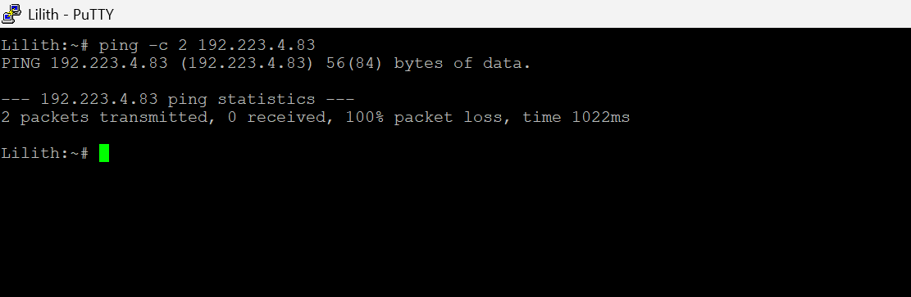

#### Hasil Diagnosa di `Shigeru`


### Analisis 4 Penyebab & Penjelasan Gejala
Ditemukan **4 penyebab sabotase** pada `Shigeru`:
1. **`net.ipv4.ip_forward` diubah menjadi `0`:** `Shigeru` berhenti meneruskan paket lintas interface. Itulah alasan **`Armisael` tetap bisa mem-ping gateway-nya sendiri (`192.223.4.81`)** (karena trafik lokal langsung ke interface `Shigeru`), sementara ping dari `Lilith` ke `Armisael` tidak diteruskan.
2. **Default route dibelokkan ke bawah (`default via 192.223.4.170 dev eth2`):** Rute default diarahkan ke `Makoto` (`192.223.4.170`) alih-alih ke atas menuju `Gendou` (`192.223.4.129` di `eth0`), memicu *routing loop*.
3. **Rute `blackhole 192.223.4.72/29`:** Semua paket balasan yang menuju subnet `Switch-Dogma` (`Lilith` = `192.223.4.74`) dibuang diam-diam (*silent drop*).
4. **Policy-Based Routing `ip rule` prioritas `90` (`from all iif eth1 lookup 100`):** Semua trafik yang masuk dari `eth1` (`Switch-Monolith`: `Armisael` & `Zeruel`) dipaksa melihat tabel routing `100` sebelum sempat mengecek tabel `main` (prioritas `32766`).

### Script Perbaikan (`/root/fix_soal9.sh` di `Shigeru`)
```sh
#!/bin/sh
sysctl -w net.ipv4.ip_forward=1
ip route del blackhole 192.223.4.72/29 2>/dev/null || true
ip rule del pref 90 2>/dev/null || true
ip route flush table 100 2>/dev/null || true
sh /root/shigeru.sh
```

#### Kondisi `Shigeru` Setelah Perbaikan
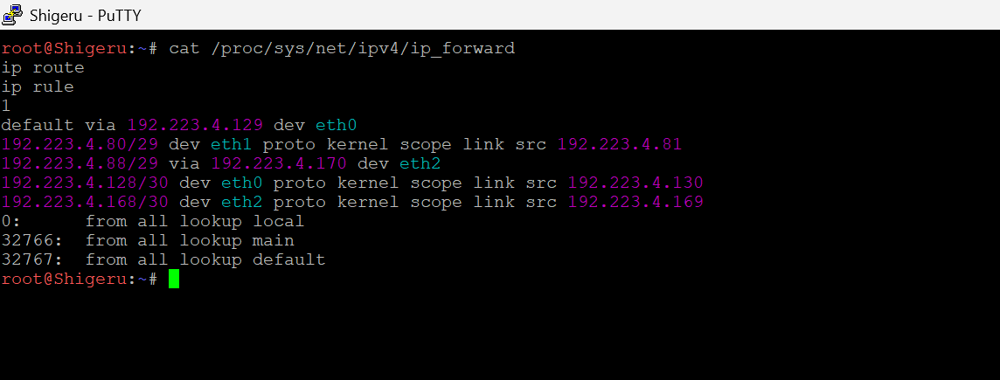

#### Bukti `Lilith` Berhasil Ping `Armisael` Kembali


---

## Soal 10 — Para Pilot Terkunci di Dalam (`break_nat.sh` di `Misato` & `Gendou`)

### Eksekusi Sabotase & Diagnosa (Tanpa Membaca Script)
Script `break_nat.sh` dijalankan di **`Misato`** dan di **`Gendou`**, lalu diperiksa tabel `filter`, `nat`, dan `mangle` di kedua router:
```bash
curl -fL "https://drive.usercontent.google.com/download?id=1oX7r9BmMPumqrIb71Vbk43Y6CQEOvDRJ&export=download&confirm=t" -o /tmp/break_nat.sh
bash /tmp/break_nat.sh

iptables -S
iptables -t nat -S
iptables -t mangle -S
```

#### Gejala Sebelum Perbaikan
- **`Unit-01` (`Switch-Cage`)** gagal ping `8.8.8.8` (100% loss), namun ping ke `Lilith` (`192.223.4.74`) tetap berhasil:
  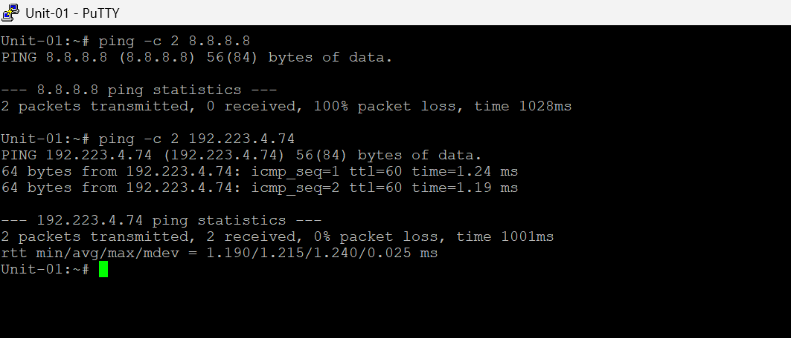
- **`Spy` (`Switch-Intel`)** tetap berhasil ping `8.8.8.8` tanpa kendala:
  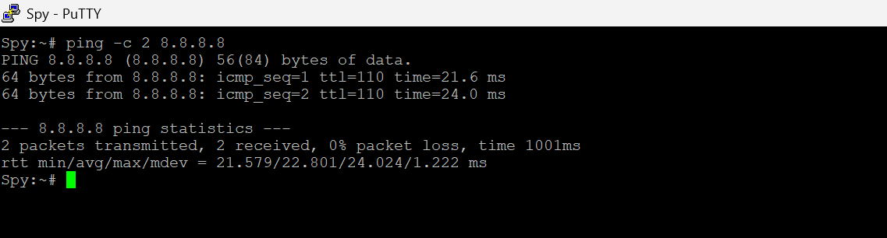

#### Hasil Diagnosa di `Misato` dan `Gendou`
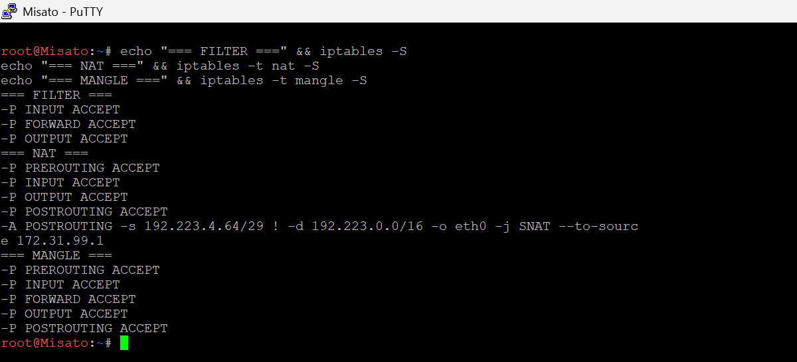
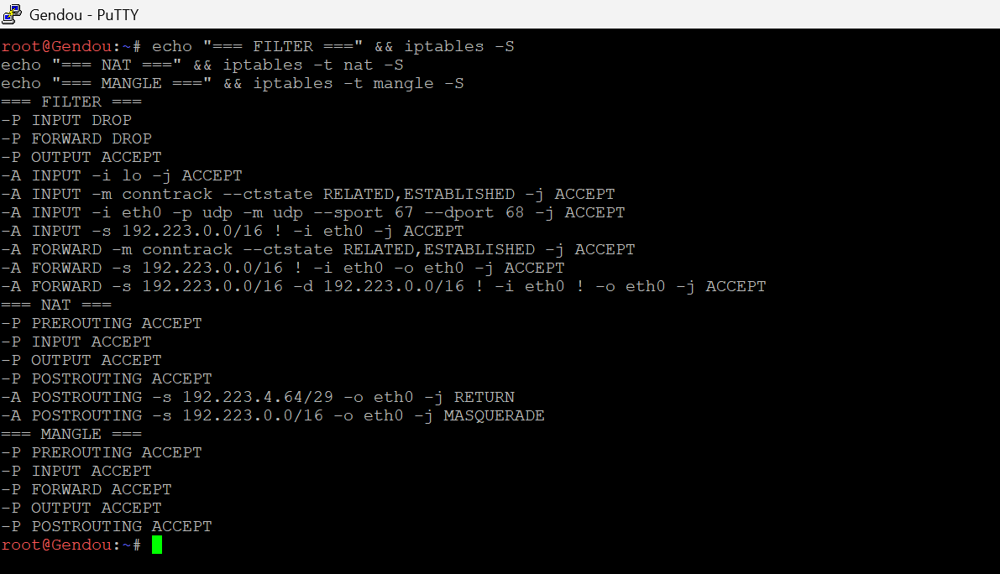

### Analisis 2 Penyebab & Jawaban Pertanyaan Soal 10
Ditemukan **2 penyebab sabotase** pada tabel `nat` chain `POSTROUTING`:
1. **Di `Misato`:** Terdapat rule `-A POSTROUTING -s 192.223.4.64/29 ! -d 192.223.0.0/16 -o eth0 -j SNAT --to-source 172.31.99.1`.
   - Setiap paket dari `Switch-Cage` (`192.223.4.64/29`) yang menuju internet (`! -d 192.223.0.0/16`) diterjemahkan sumbernya secara salah menjadi `172.31.99.1`. Saat sampai di `Gendou`, paket langsung kena `FORWARD DROP` karena firewall `Gendou` hanya mengizinkan sumber `192.223.0.0/16`.
   - Ping dari `Cage` ke `Lilith` (`192.223.4.74`) tetap normal karena syarat `! -d 192.223.0.0/16` mengecualikan trafik tujuan internal.
2. **Di `Gendou`:** Terdapat rule `-A POSTROUTING -s 192.223.4.64/29 -o eth0 -j RETURN` tepat di atas rule `MASQUERADE`.
   - Rule `RETURN` membuat paket dari `Switch-Cage` keluar dari chain `POSTROUTING` sebelum menyentuh `MASQUERADE`, sehingga alamat sumbernya tidak diterjemahkan saat keluar `NAT1`.
3. **Kenapa `Switch-Cage` terdampak tapi `Switch-Intel` (`Spy`) tidak?**
   - Kedua rule sabotase hanya menargetkan sumber `-s 192.223.4.64/29` (`Switch-Cage`), sedangkan `Spy` (`192.223.4.102/30`) berada di subnet `192.223.4.100/30` dan melewati `Kaji -> Gendou`, sehingga langsung diterjemahkan normal oleh `MASQUERADE` di `Gendou`.
4. **Di router mana alamat sumber diterjemahkan?**
   - Saat sabotase: diterjemahkan secara keliru oleh **`Misato`** menjadi `172.31.99.1`.
   - Setelah perbaikan (kondisi benar): alamat sumber seluruh jaringan internal (termasuk `Unit-01`) **hanya diterjemahkan di satu router, yaitu `Gendou`** (melalui `MASQUERADE` pada `eth0` menuju `NAT1`).

### Script Perbaikan (`/root/fix_soal10.sh`)
- **Di `Misato` (`/root/fix_soal10.sh`):**
  ```sh
  #!/bin/sh
  iptables -t nat -F POSTROUTING
  ```
- **Di `Gendou` (`/root/fix_soal10.sh`):**
  ```sh
  #!/bin/sh
  sh /root/gendo.sh
  ```

#### Bukti Kondisi Setelah Perbaikan (`Misato`, `Gendou`, dan `Unit-01`)

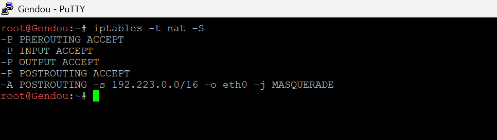
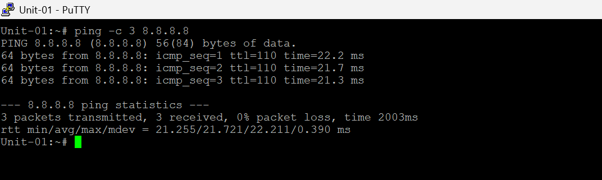

---


